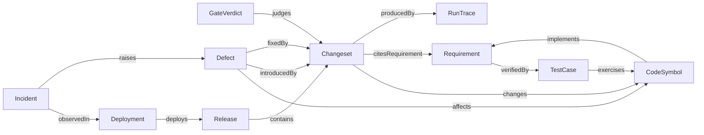

# EG-SDLC — Design and implementation plan

Governing spec: [spec.md](spec.md).
Code: ../../crates/eg-compute/src/parser/tree_sitter.rs ../../src/server/dispatch/router/source_ingest.rs

## Existing system and reuse

| Need | Existing owner |
|---|---|
| Changeset record and accept path | EG-SCM-R002, EG-SCM-R003 |
| Gate verdict record | EG-SCM-R008 |
| Culprit search over the chain | EG-SCM-R009 |
| Run provenance on a changeset | EG-SCM-R012 |
| Code and test entities with byte spans | EG-REPO-INGEST-R600, `crates/eg-compute/src/parser/tree_sitter.rs:249` |
| Commit and change-coupling graph | EG-REPO-INGEST-R601 |
| Source, test, spec and release bridge relations | EG-REPO-INGEST-R009 |
| Spec-folder typed nodes | EG-ORCH-VOCAB-R012 |
| Run trace records and step digests | EG-ORCH-VOCAB-R009, EG-ORCH-VOCAB-R013 |
| Operational incidents | EG-UNIFIED-DATA-PLANE-R760 |
| Replayable decision records | EG-DECISION-ENGINE-R007, EG-DECISION-ENGINE-R019 |
| Rule inference and closure | EG-FEDERATED-QUERY-R608 |

This spec adds three record kinds: Release, Deployment and Defect. It adds one edge vocabulary
and one derivation pass. It adds the triage decision and the status derivation. It adds no store.

## Architecture

### Record kinds and edges



The ontology terms live in `crates/eg-core/ontology/sdd-v1.ttl`. The SHACL shapes live beside
them. Existing classes keep their owners. `:Requirement` comes from EG-ORCH-VOCAB-R012.9.
`:Changeset` and `:GateVerdict` come from EG-SCM. `:CodeSymbol` and `:TestCase` map to the
EG-REPO-INGEST-R600 entities.

### Derivation rules

Each rule is a named, versioned, deterministic function of the changeset log and the code graph.
A derived edge carries the rule name, the rule version and the input digests.

| Rule | Input | Output edge |
|---|---|---|
| `changes.span_overlap` | Changeset path spans at the parent and the new revision | `changes` Changeset to CodeSymbol |
| `cites.trailer` | Structured `spec_ids` of the changeset (EG-SCM-R002.1) | `citesRequirement` |
| `implements.cited_change` | `changes` plus `citesRequirement` on the default branch | `implements` CodeSymbol to Requirement |
| `verified.binding` | Test binding markers in the tree at a revision | `verifiedBy` Requirement to TestCase |
| `exercises.call_graph` | Test-to-symbol calls from EG-REPO-INGEST-R600 | `exercises` TestCase to CodeSymbol |
| `contains.release_range` | Release head and the previous release head | `contains` Release to Changeset |
| `introduced.bisect` | Culprit of EG-SCM-R009 | `introducedBy` Defect to Changeset |
| `fixed.trailer` | Structured `fixes` of the changeset | `fixedBy` Defect to Changeset |

Manual writes of a derived edge are refused. A rebuild replays the rules over the log and must
reproduce the edge set byte for byte.

### Releases and deployments

A release names a repository, a version, a ref, the changeset head and the artifact digests. A
deployment names an environment, a workload, the image digest and the outcome. The engine links
a deployment to a release by artifact digest. A deployment with an unknown digest stays
`unattributed`. It never guesses a release.

### Defect intake

Five paths open a defect. They are a failed gate verdict, a failed run trace and an incident.
The other two are a connector issue record and a direct filing. The engine computes a signature digest from the normalized
symptom. An open defect with the same signature absorbs the new symptom.

### Defect triage

Triage is a choice, so the engine decides it. The decision reads the symptom frames, blame,
the bisect culprit, path ownership and recent authors. It proposes severity, suspected symbols,
an owner and a duplicate link. It abstains with a typed reason when evidence is insufficient.

### Derived requirement state

The engine derives `SPECIFIED`, `LANDED` and `VERIFIED` per the shared spec standard.

```text
LANDED   := exists changeset C on the default-branch chain with ID in C.spec_ids
VERIFIED := LANDED and exists TestCase T in tree(head) with verifiedBy(ID, T)
rollup   := lowest state of its children
withdraw := a Spec-Withdraw trailer removes the binding evidence for that ID
```

The served answer carries the evidence: changeset ids and test ids. A generated `status.json`
remains an export of this answer.

### Lifecycle queries

UQL answers the competency questions over the edge set. Four examples follow.

- Which requirements lack a bound test?
- Which deployment runs the code of a requirement?
- Which open defects affect symbols in a release?
- Which changesets differ between two deployments?

## Interfaces and data model

- `RecordRelease { tenant, repo, version, ref, changeset_head, artifact_digests }` returns the sealed release record.
- `RecordDeployment { tenant, environment, workload, image_digest, started_at, finished_at, outcome }` returns the deployment and its release link.
- `FileDefect { tenant, repo, intake, symptom, severity_hint? }` returns the defect id and the dedup outcome.
- `TriageDefect { tenant, defect_id }` returns the triage decision record.
- `TransitionDefect { tenant, defect_id, to, evidence_ref }` returns the new state.
- `SpecStatus { tenant, repo, rev, spec_id? }` returns each row state with its evidence.
- `LifecycleTrace { tenant, anchor, depth }` returns the reachable lifecycle records.

## Live integration path

1. EG-SCM-R003 accepts a changeset. The accept path calls the re-index hook of EG-SCM-R006.
2. The re-index hook calls `derive_lifecycle_edges` in `crates/eg-core/src/lifecycle/derive.rs`.
3. For an ingested git repository, `IndexRepository` at `src/server/dispatch/router/source_ingest.rs:24` calls the same function.
4. `RecordGateVerdict` of EG-SCM-R008 calls the defect intake on a failed verdict.
5. arbora serves the methods above through `ARBORA-OPS-R853`.

## Quality and release gates

Standard repository gates apply: Clippy, tests, jscpd, CCCC, dupehound and KISS. The
derivation pass must pass the no-duplicate-authority check against EG-REPO-INGEST-R009. The
status derivation has a differential test against the shared status generator.

## Risks, alternatives, and decisions

- **Derived, not declared.** Agents never write lifecycle edges by hand. Rules derive them, so the graph cannot drift from the log.
- **Status from the graph.** The derived state replaces hand-run status files as truth. A file export stays for public pages.
- **Defect is not incident.** An incident is an operational event. A defect is a code fault. An incident may raise a defect.
- **Risk:** test binding markers vary by language. The `verified.binding` rule reads the two marker forms of the spec standard only.
