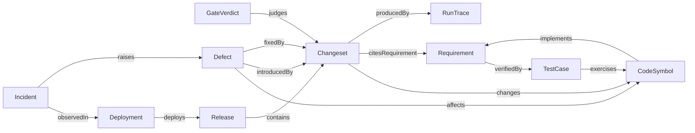

# MEDULLA-SDLC — Design and implementation plan

Governing spec: [spec.md](spec.md).
Code: ../../crates/medulla-compute/src/parser/tree_sitter.rs ../../src/server/dispatch/router/source_ingest.rs

## Summary

The engine holds the whole software lifecycle as typed records. This plan extends that chain with spec artifacts as graph records. A deterministic parser ingests specs, rows, plans, tasks and contracts with the repository code graph. Per-file digests keep the ingest incremental. Competency questions, task dispatch, a research loop and typed proposals read those records. The existing owners are reused: MEDULLA-SCM for changesets and gates, MEDULLA-REPO-INGEST for code items, and MEDULLA-DECISION-ENGINE for decisions.

## Technical Context

- **Language/Version**: Rust 2024 (engine), Python 3.14 (served tests)
- **Primary Dependencies**: `medulla-core`, `medulla-types`, `medulla-compute` parser crate
- **Storage**: the one engine graph; no second store
- **Testing**: Rust crate tests and served Python tests at L3 and L4 through the wire
- **Target Platform**: the engine server executable on Linux
- **Project Type**: service (native engine)
- **Performance Goals**: one-file spec change re-ingest under 1 s; full spec set under 30 s; competency answer p99 150 ms
- **Constraints**: no model call in ingest; no direct spec writes by the evolution loop; packs extend core classes
- **Scale/Scope**: 5,000 rows, 5,000 task lines and 50 contracts per repository

## Constitution Check

- Native Rust, single fact store: pass. Records, parser and decisions are Rust code in this repository. No second store exists.
- R-II Every wait has a deadline: pass. The ingest job and dispatch use bounded waits (R014.2, R015.1).
- R-III Every row sets budgets and names a benchmark: pass. Each new behaviour row names a budget and a bench group.

## Project Structure

```text
crates/medulla-compute/src/parser/spec_artifacts.rs   new   deterministic parser (R014.1)
crates/medulla-core/ontology/sdd-spec-v1.ttl          new   ontology pack (R014.5)
crates/medulla-types/src/lifecycle.rs                 existing  Proposal, Goal, ProjectMode types
src/server/handlers/source_ingestion/spec_projection.rs   existing  incremental ingest and linking
src/server/handlers/lifecycle.rs                      existing  mode, goal and proposal methods
src/server/handlers/decide/family/task_context.rs     new   run-context assembly (R015.2)
specs/development-lifecycle/contracts/                new   seam contracts
```

## Phase 0: Research

No unknowns. The budgets of R014.2 are starting defaults. A measurement on this platform replaces them.

## Phase 1: Design

### Existing system and reuse

| Need | Existing owner |
|---|---|
| Changeset record and accept path | MEDULLA-SCM-R002, MEDULLA-SCM-R003 |
| Gate verdict record | MEDULLA-SCM-R008 |
| Culprit search over the chain | MEDULLA-SCM-R009 |
| Run provenance on a changeset | MEDULLA-SCM-R012 |
| Code and test entities with byte spans | MEDULLA-REPO-INGEST-R600, `crates/medulla-compute/src/parser/tree_sitter.rs:249` |
| Commit and change-coupling graph | MEDULLA-REPO-INGEST-R601 |
| Source, test, spec and release bridge relations | MEDULLA-REPO-INGEST-R009 |
| Spec-folder typed nodes | MEDULLA-ORCH-VOCAB-R012 |
| Run trace records and step digests | MEDULLA-ORCH-VOCAB-R009, MEDULLA-ORCH-VOCAB-R013 |
| Operational incidents | MEDULLA-UNIFIED-DATA-PLANE-R760 |
| Replayable decision records | MEDULLA-DECISION-ENGINE-R007, MEDULLA-DECISION-ENGINE-R019 |
| Rule inference and closure | MEDULLA-FEDERATED-QUERY-R608 |

This spec adds three record kinds: Release, Deployment and Defect. It adds one edge vocabulary
and one derivation pass. It adds the triage decision and the status derivation. It adds no store.

### Architecture

#### Record kinds and edges



The ontology terms live in `crates/medulla-core/ontology/sdd-v1.ttl`. The SHACL shapes live beside
them. Existing classes keep their owners. `:Requirement` comes from MEDULLA-ORCH-VOCAB-R012.9.
`:Changeset` and `:GateVerdict` come from MEDULLA-SCM. `:CodeSymbol` and `:TestCase` map to the
MEDULLA-REPO-INGEST-R600 entities.

#### Derivation rules

Each rule is a named, versioned, deterministic function of the changeset log and the code graph.
A derived edge carries the rule name, the rule version and the input digests.

| Rule | Input | Output edge |
|---|---|---|
| `changes.span_overlap` | Changeset path spans at the parent and the new revision | `changes` Changeset to CodeSymbol |
| `cites.trailer` | Structured `spec_ids` of the changeset (MEDULLA-SCM-R002.1) | `citesRequirement` |
| `implements.cited_change` | `changes` plus `citesRequirement` on the default branch | `implements` CodeSymbol to Requirement |
| `verified.binding` | Test binding markers in the tree at a revision | `verifiedBy` Requirement to TestCase |
| `exercises.call_graph` | Test-to-symbol calls from MEDULLA-REPO-INGEST-R600 | `exercises` TestCase to CodeSymbol |
| `contains.release_range` | Release head and the previous release head | `contains` Release to Changeset |
| `introduced.bisect` | Culprit of MEDULLA-SCM-R009 | `introducedBy` Defect to Changeset |
| `fixed.trailer` | Structured `fixes` of the changeset | `fixedBy` Defect to Changeset |

Manual writes of a derived edge are refused. A rebuild replays the rules over the log and must
reproduce the edge set byte for byte.

#### Releases and deployments

A release names a repository, a version, a ref, the changeset head and the artifact digests. A
deployment names an environment, a workload, the image digest and the outcome. The engine links
a deployment to a release by artifact digest. A deployment with an unknown digest stays
`unattributed`. It never guesses a release.

#### Defect intake

Five paths open a defect. They are a failed gate verdict, a failed run trace and an incident.
The other two are a connector issue record and a direct filing. The engine computes a signature digest from the normalized
symptom. An open defect with the same signature absorbs the new symptom.

#### Defect triage

Triage is a choice, so the engine decides it. The decision reads the symptom frames, blame,
the bisect culprit, path ownership and recent authors. It proposes severity, suspected symbols,
an owner and a duplicate link. It abstains with a typed reason when evidence is insufficient.

#### Derived requirement state

The engine derives `SPECIFIED`, `LANDED` and `VERIFIED` per the shared spec standard.

```text
LANDED   := exists changeset C on the default-branch chain with ID in C.spec_ids
VERIFIED := LANDED and exists TestCase T in tree(head) with verifiedBy(ID, T)
rollup   := lowest state of its children
withdraw := a Spec-Withdraw trailer removes the binding evidence for that ID
```

The served answer carries the evidence: changeset ids and test ids. A generated `status.json`
remains an export of this answer.

#### Lifecycle queries

UQL answers the competency questions over the edge set. Four examples follow.

- Which requirements lack a bound test?
- Which deployment runs the code of a requirement?
- Which open defects affect symbols in a release?
- Which changesets differ between two deployments?

#### Spec artifact graph

The parser turns each artifact file into triples. Tables give Requirement records. Headings give PlanSection records. Task lines give Task records with T-id, parallel flag, story, row reference and checked state. Contract files give Contract records and `crossesSeam` edges. A store keeps one digest per file. A changed digest re-ingests only that file. A file that leaves the tree loses its records. Every ontology pack class extends a core class. The pack rolls up to the core.

Bundle plans under `releases/` and program plans ingest as plan records. A plan record links to the rows and tasks it covers. A question for the plan to reach a goal or phase returns plan sections with open tasks in order.

#### Project mode

Each codebase has a ProjectMode record: `reference`, `development` or `evolving`. A reference codebase never receives a proposal. Promotion to `evolving` needs operator approval. A Fixed knob protects that rule from the evolution loop.

#### Task dispatch, research and evolution

`Decide` with `TaskPlan` builds dependency layers from Task records. The engine assembles a context for each task and hands it to an agent run. The run result enters only through `SubmitChangeset` and the gates. A failure files a defect and raises evidence for a proposal. A plan unknown triggers research through the connectors. Findings return as cited proposals. Proposals have twelve closed kinds and land only as pull requests.

### Interfaces and data model

- `RecordRelease { tenant, repo, version, ref, changeset_head, artifact_digests }` returns the sealed release record.
- `RecordDeployment { tenant, environment, workload, image_digest, started_at, finished_at, outcome }` returns the deployment and its release link.
- `FileDefect { tenant, repo, intake, symptom, severity_hint? }` returns the defect id and the dedup outcome.
- `TriageDefect { tenant, defect_id }` returns the triage decision record.
- `TransitionDefect { tenant, defect_id, to, evidence_ref }` returns the new state.
- `SpecStatus { tenant, repo, rev, spec_id? }` returns each row state with its evidence.
- `LifecycleTrace { tenant, anchor, depth }` returns the reachable lifecycle records.

- `ProjectModeSet { tenant, repo, mode, approval_ref? }` returns the ProjectMode record.
- `GoalPut { tenant, repo, statement, targets }` returns the Goal record.
- `ProposalPut`, `ProposalList` and `ProposalDecide` write, list and decide proposals.
- Contracts: [spec-artifact-graph](contracts/spec-artifact-graph.md) and [proposal-review](contracts/proposal-review.md).

## Phase 2: Task approach

`tasks.md` holds one task line per row, producer first. Model rows come before behaviour, wiring and hot-path rows. Rows `R014.1`, `R014.5`, `R016.5` and `R017.2` carry `[P]` because they share no file with their siblings.

## Complexity Tracking

None. The constitution check passed.

## Build contract

Standard repository gates apply: Clippy, tests, jscpd, CCCC, dupehound and KISS. The
derivation pass must pass the no-duplicate-authority check against MEDULLA-REPO-INGEST-R009. The
status derivation has a differential test against the shared status generator.

The ingest budget gates are the bench groups `lifecycle/spec_parse` and `lifecycle/spec_ingest`. The parser makes no model call, and a test proves it.

## Production caller chain

1. MEDULLA-SCM-R003 accepts a changeset. The accept path calls the re-index hook of MEDULLA-SCM-R006.
2. The re-index hook calls `derive_lifecycle_edges` in `crates/medulla-core/src/lifecycle/derive.rs`.
3. For an ingested git repository, `IndexRepository` at `src/server/dispatch/router/source_ingest.rs:24` calls the same function.
4. `RecordGateVerdict` of MEDULLA-SCM-R008 calls the defect intake on a failed verdict.
5. arbora serves the methods above through `ARBORA-OPS-R853`.
6. The repository-manager ingest job calls `SourceIngest`. `index_repository` in `src/server/dispatch/router/source_ingest.rs` calls `reingest_changed_artifacts`, which parses and links the spec artifacts (R014.8).
7. arbora serves the artifact reads, the run dispatch, the mode and the proposal operations through `ARBORA-OPS-R896`.
8. `run.dispatch` calls `Decide` with `TaskPlan`. The engine hands each task to a run through the MERISTEM-SCM task-run row. The result returns through `SubmitChangeset` and the gates.

Obsolete paths: no hand-run status file is truth, and no spec file is written outside a changeset.

## Cross-repo seams

- `ARBORA-OPS-R853` and `ARBORA-OPS-R896.1` to `R896.5` serve the lifecycle, artifact, mode, run and proposal operations. Contracts: `contracts/spec-artifact-graph.md`, `contracts/proposal-review.md`.
- `PIPE-GATES-R004` and `PIPE-CONNSPEC-R009` publish gate verdicts and read the derived state.
- `PIPE-RELEASE-R025` computes release plans that `MEDULLA-SDLC-R018` ingests.
- `MERISTEM-SCM-R011.2` performs one task run. `OVERSTORY-DECIDE-R009` shows proposals.
- `MEDULLA-DECISION-ENGINE-R134.111`, `R705`, `R654`, `R811`, `R817`, `R805` and `R179` own the decisions that this spec consumes.

## Risks, alternatives, and decisions

- **Derived, not declared.** Agents never write lifecycle edges by hand. Rules derive them, so the graph cannot drift from the log.
- **Status from the graph.** The derived state replaces hand-run status files as truth. A file export stays for public pages.
- **Defect is not incident.** An incident is an operational event. A defect is a code fault. An incident may raise a defect.
- **Risk:** test binding markers vary by language. The `verified.binding` rule reads the two marker forms of the spec standard only.
- **Deterministic ingest.** A model call in ingest makes state irreproducible and slow. The parser reads fixed forms only.
- **Proposals are not writes.** A loop that edits specs directly bypasses review. Every change goes through a pull request.
- **Risk:** the parser refuses an unknown file form and names the file and line. Authors fix the source.

## North star

The engine drives development from its own graph. Specs, plans, tasks and contracts are records. A planner asks the next unblocked task and gets its context. Agent runs implement it, the gates accept it, and the evolution loop proposes improvements for review. The exit gate is the competency question set of `MEDULLA-SDLC-R014.6` answered through the served path (`MEDULLA-CQ-ORCH`).

## Delivery phase

Rows `R014` to `R018` serve P5. The next-task question of `R014.6` supports the execution-plan answer of `MEDULLA-CQ-ORCH-R012` in scenario `ARBORA-ACCEPTANCE-R006.7`. Row `R012.8` sets the mode that gates every proposal and has no phase of its own. Rows `R001` to `R006` and `R012.1` to `R012.7` serve P1 to P4.
