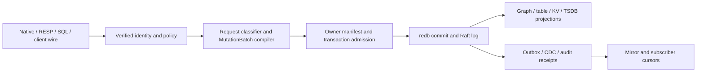

# Implementation plan

## Build sequence

1. **Baseline and proof harness.** Pin one main revision and inventory the listed entry points. Record existing focused and hosted gate results. Add reproducible fault/cluster fixtures. Mark each work ID as queued, built, landed, or accepted only from actual evidence.
2. **Transaction and storage authority (KG-01–04).** Add the cross-store ADR and enforce pre-effect refusal or atomic commit. Keep owner binding at the existing manifest/write boundary. Add lineage fixtures and bounded scrub. Verify table-only traffic stays in its present atomic path.
3. **Policy and audit (KG-07–09).** Thread the verified authority context through every native/read/wire path; cover foreign sources, UDFs, KV, TSDB and caches. Add reserved audit and lease kinds through the existing audit store and capability registry. Define generated client error codes before changing callers.
4. **Outbox, replication and mirrors (KG-05–06, KG-10).** Repair head attempts and replay; add per-consumer cursor/reconcile using committed ChangeEnvelope events. Add failure trace capture and repeated multi-node tests. Expand mirror sinks to user tables only after source/target digest and schema semantics are specified.
5. **Native performance (KG-11–15).** Make durability visible and measured, then add RAM working structures, batching and classification. Extend the existing dependency clock plan cache. Run store-engine ADR and benchmark matrix; publish precise per-workload results.

## Integration and migration

Persisted formats change only behind lineage versions and migration/rollback fixtures. Existing sync namespaces retain sync semantics until explicitly reconfigured. Existing client/wire methods continue to use the canonical MutationBatch path. Generated clients are regenerated from the authoritative protocol contract rather than hand edited. A mirror or replica is introduced in shadow mode, reconciled against source digest, then promoted by explicit operation. Restart resumes its cursor. If a new path lacks authorization or audit parity, it is not wired into serving.

## Definition of done

Each task names a `KG-*` requirement, tests its normal and refusal cases, and records exact revision plus CI links. `pre-commit run --config .config/pre-commit.yaml --all-files` and `bash scripts/ci_parity.sh` are the repository's broad configured checks; focused cargo tests and cloud CI are required for affected packages. CCCC, Dupehound, jscpd differential, KISS, rust architecture lint and clippy must have evidence at the same head. A missing scanner is a setup failure, not a pass. Live cluster/system proofs may add confidence but cannot replace reproducible container or process fixtures available to outside contributors.

No acceptance status changes until a reviewer can trace requirement → code entry point → positive/negative test → exact merged revision. Document only changed public wire contracts and operational behavior needed by contributors; generated documentation has its own source-of-truth workflow.

## Worker registry sequence

Implement R074.1 in eg-types with explicit caller-supplied timestamps and checked TTL arithmetic. Preserve capacity facts through heartbeat and expire at now >= deadline. Then R074.2 consumes that module through authenticated tenant/principal-scoped dispatch and regenerates contracts; verify the served path before completing the parent.

## Scheduler producer-first decomposition

R076 spans pure data and the served setting/admission boundary, so the SPEC-SIZING producer-first split is R076.1 followed by R076.2. Deliver and test the native `eg-types` contract first, then connect it to the engine with served tests. Keep the parent open until both children are met. No server or worker policy is changed by the first slice.

## Architecture

### Existing path to extend

`src/server/mutation_batch.rs` compiles and commits the request, `crates/eg-types/src/mutation_batch/` defines its persisted envelope, `crates/eg-transaction` admits it, `crates/eg-storage/src/owner/` binds a store owner, and `src/redb_store/` applies it. `src/raft/store/` handles replicated log/state-machine commits. `src/server/{auth,authority_context,sql_catalog_acl,kv,cdc}.rs` and the wire directories feed that same kernel. `crates/eg-tsdb/src/store.rs` and `crates/eg-stream/` are existing series and stream owners. These are extension points, not proposals to replace them.

No arrow bypasses identity, owner binding, or transaction admission. A native fast path may skip the SQL planner only. Derived hot structures and Parquet copies can be rebuilt from committed authority; they cannot accept independent authoritative writes.

### Stable interfaces

| Contract | Producer → consumer | Invariant |
|---|---|---|
| `MutationBatch` + terminal result | wire/compiler → transaction + redb/Raft | canonical request digest, verified scope, idempotency key, member set and one terminal outcome |
| `OwnerManifest` lineage | storage registry → loader/writer | version and member ownership checked on read; unsupported layout gives named refusal |
| `ChangeEnvelope` + position | committed stream → CDC subscriber | monotonic source position, replay-safe key, schema version, no uncommitted event |
| Audit reservation/outcome | effect caller → EG audit store | `PENDING` before effect; linked completed/failed/indeterminate result; no outcome forgery |
| Mirror cursor | committed stream → target sink | per-target durable checkpoint advanced only after idempotent target apply |
| Auth context | verified transport → all executors | tenant and principal survive every route; no caller-supplied scope substitution |

### Commit and recovery

Admission checks identity, scope, capability, owner member set, lineage, size and idempotency before opening a write transaction. For a single redb shard, graph and table members should share one redb `WriteTransaction`. Otherwise, an ADR must choose a recoverable intent protocol or a clear pre-effect refusal. A multi-shard/replicated batch must identify the commitment and replay boundary and preserve deterministic ordering. It must return one terminal result after durable acknowledgement. Crash injection must cover before-admission, after-intent, after-member-write, before-seal, after-seal, before-reply and after-reply. Each case must yield only absent or fully committed state, with idempotent retry after lost acknowledgement.

Owner binding is validated once per write transaction and cached only for that transaction. A manifest format bump retains a golden fixture for each supported predecessor and a named refusal for unsupported lineage. A background scrub uses bounded read transactions, a persisted/resumable key cursor and a rate cap. It never repairs data silently. Typed findings include member, key digest, error class and first/last observed time without leaking payloads.

### Policy, audit and streaming

The transport verifies claims; all read executors and the native fast path take an immutable scoped authority context. RLS predicates apply before returning or joining user data. Explicit grants are resolved at use time, so revoke takes effect on the next request. KV keys retain principal-bound HMAC partitioning in every durability class. Audit reservation must be durable before any governed effect; an interrupted worker leaves `PENDING` for reconciliation, not a fabricated success. The outbox increments attempts for the head actually tried. Rejected reasoning projections require rebuild rather than skip-ack. CDC and mirror checkpoints move after target apply and can replay from the previous checkpoint safely. Delivery-side cursor rows stay local to their owner unless a versioned replicated contract proves otherwise.

The deployment may offer `none`, `local`, or `external` authentication, but all modes produce the same internal principal/RBAC context before dispatch. `none` is an explicit single-principal development mode and must not mint an administrative identity from a client-supplied name. `local` owns password/session lifecycle in EG; `external` validates issuer, audience, tenant and policy-version binding before mapping claims. Switching modes must not reinterpret an old session as another principal. Every mode uses the same scope checks, request digest, audit class and access-denied errors. JIT elevation is a separate reserved `rbac.elevation` lease. The proposer and approver are distinct verified principals. The digest is exact, and expiry is checked on every use. Ordinary lease-write capability cannot issue it. Schema repair uses its own reserved kind with the same two-person invariant.

### Native storage expansion

Classify requests before planner allocation. Only an exact supported point/structure form takes the native route; ambiguous SQL stays in the SQL planner. Prepared SQL cache keys include statement digest, dialect, schema version, authorization scope and relevant dependency-clock generation. Schema or policy changes invalidate before reuse. `sync` is default and cannot be silently changed. `async` acknowledges within its advertised maximum loss window and exports observed oldest-unflushed age. It blocks/degrades explicitly if it cannot honor ≤100 ms. `ephemeral` is advertised as non-recoverable. Hot structures are reconstructed deterministically from the durability log; compaction and hot/cold union preserve tombstone/version order. The store-engine comparison is an ADR based on reproducible captured workload fixtures, not a second authority design.

### Cross-product boundaries

The [`unified-data-plane`](../unified-data-plane/spec.md) spec owns attached-source adapters, catalog mapping, upstream CDC capture, and federated query routing. It submits canonical envelopes and consumes EG positions. Serving products may call the audit API but cannot implement an independent audit log or skip reservation when unavailable. Finance can use TSDB and transactions, but this kernel contains no trading decision or order policy. These links are to local repository contracts; implementing this spec requires no private inventory.

### Design decisions to record before implementation

1. Cross-store atomicity ADR: same redb transaction versus recoverable intent versus bounded refusal, with measured failure matrix.
2. Native hot-store ADR: redb versus alternatives with persistence/latency/restore comparisons.
3. Durability-class wire contract: how class, measured loss window and failure state are exposed for each protocol.
4. Mirror/replication compatibility contract: schema evolution, ordering, cursor, restore and security behavior.

### Analytics worker carry-over

The agent-utilities analytics worker (removed in AU-SEMANTIC-R011.10) was a remote client of the engine's existing `eg-jobs` plane, not a separate queue. It opened one engine connection per slot with a service identity holding scopes `kg:write` and `analytics:worker`. It claimed jobs with `worker_claim` and checkpointed at progress 0.1 and 0.9. It stage-published a typed result and called `worker_publish`. It had no schedule: it polled. Schedules for analytics belong to `JobIntent` in `crates/eg-jobs`, which this spec does not change.

The engine already runs the same loop in-process (`ensure_job_workers`), so the owning process for mining is the engine. A second process only adds a network hop and a second copy of the kernel. If a remote worker is ever needed, graph-os hosts it and uses the generated client. Graph-os deploys engine-adjacent services. Agent-utilities does not host this worker. The generic task queue in `EG-DURABLE-KERNEL-R071` to `R077` serves other work and is not used by this path.

| Old entry point | New entry point | Status |
|---|---|---|
| console script `graph-os-analytics-worker` | colocated pool, `EG_ANALYTICS_WORKERS` | exists (R082.1) |
| payload decode and bounds | submit-time validation | exists, verify (R082.2, R082.3) |
| rule identity, result shape | `results_association.rs` | exists, verify (R082.4, R082.5, R082.6) |
| status polling, cancel, deadline, cpu budget | executor stop checks | exists, verify (R082.7) |
| `_slot` retry and reconnect | durable `RetryPolicy` backoff | exists, verify (R082.8) |
| slots, lease, poll environment settings | validated pool settings | to build (R082.9) |
| remote claim by capability | `JobsClient` worker operations | exists, verify (R082.10) |
| multi-endpoint reconnect cursor, signal handling, Python Eclat kernel | none | intentionally dropped: in-process execution needs none |

The mining submission boundary returns `INVALID_ARGUMENT` for non-finite or out-of-range thresholds, unsupported algorithms, and distinct-item overflow. Parameter checks run before input pseudonymization, and refusal details do not echo the supplied algorithm. Malformed transaction shapes are rejected during typed wire decoding. Default support (0.1), confidence (0.5), and algorithm (`fpgrowth`) remain unchanged.

Out of scope: new analytics families, a schedule for mining jobs, and any change to the task-queue rows. Not determinable from the deleted source: the engine kernel's own item cap (R082.3).

### Scheduler policy contract (R076.1)

`eg_types::scheduler_config::SchedulerConfig` is the sole producer of scheduler policy data. It includes explicit total workers and queue depth, a deterministic lane-floor map, and CPU per-mille default 360. The memory-per-worker default is 3,221,225,472 bytes. `validate()` rejects blank lane IDs, CPU fractions above 1000, zero memory divisors and floor sums exceeding the pool. Checked subtraction prevents floor-sum overflow. Zero pool, CPU fraction or queue depth is an explicit disabled resource. The later grant path must never override it with a floor of one. Serde rejects unknown fields and requires the two explicit limits. Deserialization alone is not policy admission: consumers must call validation before applying data.

R076.2 remains responsible for scope, persistence, served reads/updates, lane membership and real admission/queue enforcement. Worker registration supplies capacity, not an alternative policy authority. R074 worker registration and these floor keys share canonical engine lane IDs; served integration must validate membership against the same registry.

## Lifecycle control admission and fixture isolation

The control owner must bind each R049 maintenance claim to its in-transaction version.
The graph owner must retain caller-key replay and nonce enforcement.
`delete_purges_receipts_of_a_prior_incarnation` must prove recreation and subsequent replay across restart.
The shared temporary-path helper must add a process-local sequence; concurrent path tests must prove uniqueness.
Native facade acceptance remains pending.

## Clippy profile declaration coverage

R011.5 checks both required Clippy profiles through the existing release feature-matrix suite.
The R011 parent binding records partial declaration coverage only.
R011.3 and R011.4 retain their runtime and exact-head receipt obligations.
The generator must keep these three rows SPECIFIED until their own evidence exists.

## Amendments

### 2026-10-16: R024 acceptance evidence correction

At PR #605 head `4f172cb5259fe471d32e74080a74c7581243d283`, refusal tests
were bound as verification for EG-DURABLE-KERNEL-R024, EG-DURABLE-KERNEL-R024.3,
and EG-DURABLE-KERNEL-R024.4. Retain these tests as partial safety coverage,
but remove their acceptance bindings and reopen the three task checkboxes.
The canonical status generator reports LANDED for existing implementation commits.
These rows have no verification evidence. Their successful-operation acceptance remains incomplete.
R024.3 still needs successful non-AGE Cypher registration and a representative
query. R024.4 still needs mirror registration and a successful representative
mirror operation. R024 still needs representative operations for every named
backend, not merely refusal at the entry points. Requirements remain unchanged.
R024.5, R024.6 and R024.8 explicitly accept refusal tests and retain their
verification bindings. R017 and all other rows are unchanged.

### 2026-10-11: R082.6 historical ordering

EG-DURABLE-KERNEL-R082.6 previously left ascending tie keys ambiguous.
The historical miner sorts first-seen integer IDs, not label strings.
The engine must preserve this order.
AU commit `134576bd0f5931a9b22ed3c3859a3f4350731ad6` provides the original implementation.
Commit `92974bae8c3ed3a270f582300b7458d4f53571c4` deletes that implementation.
The fixture records unchanged historical mining definitions, executed without unrelated transport imports.
Six transactions use reverse-lexical labels and duplicate items.
The existing association module owns execution; its child test module owns parity checks.
No second production miner is introduced.

### 2026-10-11: R011 and R014 runtime acceptance repair

This amendment applies to EG-DURABLE-KERNEL-R011 and EG-DURABLE-KERNEL-R014.
Previously, each generated parent inherited completion from its sole typed-model child.
The parent text and source comments explicitly deferred runtime work.
Now, R011.2 through R011.4 track the manifest, pre-merge execution, and exact-head CI receipts.
R014.2 through R014.5 track load generation, repeated execution, and both cluster-test acceptance records.
The existing children retain their evidence. The original runtime obligations remain mandatory.
The repair extends existing parents because both parents already own these behaviors.
Planned children record unverified acceptance; they do not imply that every implementation is absent.

## Audit record

2026-10-11: R082.6 compares all three engines against the historical Python output.
The fixture records source identity and SHA-256.
Boundary cases cover ceiling support, minimum count, confidence tolerance, and zero consequent support.

### 2026-10-11: runtime source audit

Audited revision: `2a2f9498863250c71827cf56ecbcb9307940cff0`.
`crates/eg-types/src/pre_merge_test_module.rs` explicitly defers the concrete manifest and pre-merge gate.
`.github/workflows/ci.yml` excludes `gates-variants` from pull requests.
The same workflow declares `published-full` and `workspace-all-features` clippy profiles with Kafka dependencies.
Configuration presence does not supply passing exact-head CI receipts.
`src/raft/flake_budget.rs` explicitly defers the representative-load generator and repeated-run harness.
`scripts/validate-raft-cluster.sh` selects leader rebalance but omits the named placement-admin test.
That script records no representative-load generator or repeated-load evidence.
`src/raft/tests.rs` contains both named cluster tests.
`src/raft/harness/trace_capture.rs` owns existing causal trace capture.
No runtime suite ran during this spec-only repair.

### 2026-10-11: concrete runtime manifest

R011.2 extends `RequiredTestModule` with explicit features and Cargo arguments.
The manifest selects real library-test modules in the engine and transaction crate.
`validate_selection` refuses an empty or mismatched discovery inventory.
Eight source-module tests passed with Rust 1.96.0, including source-anchor checks.
This evidence completes the manifest child only. R011, R011.3, and R011.4 remain open.

### 2026-10-11: bounded representative CPU load

R014.2 extends the existing cluster validation script with explicit opt-in CPU load.
`RAFT_LOAD_WORKERS` accepts 1 through 32; `RAFT_LOAD_SECONDS` accepts 1 through
3600 seconds, default 300. Invalid settings refuse before compilation.
Workers begin only after the build and remain active during the test command.
The supervisor aborts on budget exhaustion or unexpected worker exit. It reaps
workers and the command process group on success, failure, SIGINT, or SIGTERM.
The supervisor logs worker count, process IDs, duration bound, and measured elapsed time.
Unconfigured callers keep the existing unloaded command. R014.3 through R014.5
remain open: process-fixture tests do not prove loaded Rust cluster acceptance.

### 2026-10-11: make manifest reproduction portable

R011.2 reproduction writes its disposable binary beneath the checkout's target directory.
The public-spec gate and its regression test must reject machine-specific paths.
This documentation repair adds no Rust execution evidence or runtime acceptance.

### 2026-10-11: repeated loaded harness

R014.3.1 adds bounded repetitions and per-invocation evidence to the existing CPU-load supervisor. R014.3.2 retains Rust FlakeBudget-driven diagnostic retries. R014.4 and R014.5 remain open until actual Rust cluster execution is recorded.

## Recovered requirement: shared KV-cache tier

Data flow: consumer put → `KvBlockKey` → tiered store → budgeted eviction → other consumer get.
Attach point: `crates/eg-kvcache/src/{version,shared,tiered}.rs`; the served operation is located by R083.4.
Reuses the existing tiered, cold and graph-importance modules.
Decision: key by model version plus prefix hash. Rejected: session-keyed blocks, which cannot be shared across parallel instances.

## EG-DURABLE-KERNEL-R084 version-checked writes

Data flow: served `ApplyMutation` → mutation envelope with `VersionExpectation::Native` (`crates/eg-jobs/src/store.rs:2537`) → `resolve_conflict` → commit or `WRITE_CONFLICT` → trace.
Types: `WriteConflict` and `MergeStrategy` in `crates/eg-types/src/write_conflict.rs`. The default strategy is `Refuse`.
Attach point: the version check at `crates/eg-jobs/src/store.rs:2537`; the caller is the served mutation path.
Failure: a stale write under `Refuse` changes nothing and returns `WRITE_CONFLICT`.
Reuses `VersionExpectation` (`crates/eg-core/src/rbac_persist/durable_write.rs:105`). New: the strategy and the typed conflict.
Decision: refuse by default. Rejected: last-write-wins, which loses data without a record.
Cross-repository: `AU-DECISIONS` callers read the conflict code; owner prefix `AU-DECISIONS`, contract `WriteConflict`.

References
- No paper is cited.

## R085: authoritative versioned memory synchronization

This is a proposed producer contract. No R085 runtime method exists yet.
Every child remains SPECIFIED until its own acceptance evidence exists.
The owning scope is durable graph state, atomic mutation and conflict retention.
R084.3, R084.4 and R084.6 supply concurrency prerequisites only.
They do not define memory snapshots, file listings or synchronization.

### Existing production boundaries

The reviewed base is `3477a5da33d4593b0248558d0501c40685f6c9f7`.
`crates/eg-types/src/protocol.rs::Request` binds graph and verified request context.
`src/server/access.rs::check_graph_access` owns graph authority checks.
`src/server/handlers/graph_ops/gateway.rs::try_handle_gateway` routes durable mutations.
Its `commit_gateway` is an existing commit entry point.
`src/server/mutation_batch/compile.rs::authoritative_graph_version` reads the durable version.
`CompileBatch::expected_graph_version` carries the existing optimistic concurrency condition.
`compile_methods_with_outbox` compiles mutation and outbox changes together.
`src/server/mutation_batch/commit/` owns durable commit and projection publication.
`src/server/handlers/graph_ops/memory.rs` serves existing memory maintenance and summary operations.
Its mutation arms explicitly require gateway routing. They do not implement this contract.

Reuse `crates/eg-types/src/contract/crypto.rs::Digest256` for content digests.
Reuse `MutationScopeIdentity` and `MutationBatch` in `crates/eg-types/src/mutation_batch/`.
Reuse named holders in `src/server/blob/store/holders.rs`.
R050 and R051 retain their garbage-collection and holder guarantees.
Do not add another persistent write envelope or an agent-owned memory store.

### Proposed public contract

The proposed wire methods are `ReadMemorySnapshot`, `ListMemorySnapshots` and `SyncMemorySnapshot`.
These names reserve design intent, not existing runtime availability.
Add typed definitions under a new `crates/eg-types/src/memory_sync.rs` module.
Declare graph-domain capabilities through `crates/eg-capabilities/src/domains/graph.rs`.
Generate request schemas, result schemas and public clients from that authority.
A missing method or incompatible contract returns unavailable to consumers.

A document key combines the verified tenant, graph incarnation and logical document ID.
The graph comes from `Request.graph`; request bodies cannot replace its authority.
Graph recreation invalidates old revisions, cursors, conflicts and acknowledgments.
Kinds are observations, reflections, profile and active_context.
A logical relative Markdown path is a presentation label, never an engine filesystem path.
Reject absolute paths, traversal and duplicate logical paths within one graph.

Each immutable snapshot carries document ID, kind, logical path, revision and parent revision.
It also carries canonical UTF-8 content, its Digest256, provenance and retention metadata.
Content uses exact UTF-8 bytes without implicit normalization. EG recomputes the digest.
Reuse checked counters and existing blob references for stored content.
Refuse oversized bodies before allocation or effects. Maximum content is 1 MiB per document.
Logical IDs and paths are bounded to 256 and 1024 UTF-8 bytes respectively.
Use checked revision increments; overflow refuses without wrapping.

Read accepts a document ID and optional exact revision.
Its result includes accepted snapshot, explicit sync state and authorized unresolved conflict references.
List accepts optional kind, a limit from 1 through 100 and an opaque cursor.
List returns metadata only, in stable document-ID order, plus the next cursor.
Bind the cursor to the authorized graph snapshot, filters and current authority.
Recheck authorization on every page. Policy changes invalidate the cursor.
Return no hidden counts, identifiers, content digests or existence information.

Sync actions form a closed set: observe_file, submit, resolve and acknowledge_materialization.
Observe_file retains a host edit and its base revision without changing the accepted head.
It returns file_ahead for a matching base, or conflict for a stale base.
Both outcomes require durable content retention and current write authority.
Submit carries expected revision, expected content digest and candidate bytes with their digest.
Creation requires explicit absence; an absent expected revision never means unconditional overwrite.
Resolve also names the retained conflict and the current accepted revision.
The result is a tagged union, with no shared accepted-head fields.
Applied carries the newly committed head, sync state and receipt identity.
Observation_retained carries the existing head, observed content reference, observation generation, sync state and receipt.
Conflict_retained carries the accepted head, both retained content references, their provenance, sync state and receipt.
Materialization_acknowledged carries the existing head, checked observation generation, sync state and receipt.
These four outcomes require authority and an existing or newly committed accepted head.
Observe_file, resolve and acknowledge_materialization require an existing authorized document.
Refused carries only a registered error code and request-local correlation identity.
It carries no accepted head, document existence, revision, digest, conflict reference or stored receipt.
This variant also represents refused creation when no accepted head exists.
Denied operations use the same redacted result whether the document exists or is absent.
Creation uses an explicit absent-head precondition; no synthetic revision represents absence.
Refusals reuse registered engine error codes; register missing typed errors before exposing this contract.
The signed request binds the action, body and existing idempotency identity.
Replay with the same identity and body returns the same receipt.
The same identity with another body refuses. Never repeat an accepted mutation.

A matching base commits the new snapshot and head atomically.
A stale authorized submission yields conflict_retained only after durable retention succeeds.
Retain the candidate and the accepted snapshot with both digests and a conflict identifier.
The accepted head remains unchanged. This is an authorized retained-conflict outcome, not an authorization refusal.
Generic R084.4 compare-and-set refusal still changes no state.
Any retry needed to record a conflict must recheck authority and the current head.
Capacity or persistence failure returns a typed refusal without claiming retained content.
Resolution requires current write authority and an exact current-head comparison.
Old conflict contents remain retained until the explicit retention policy permits release.

### Sync state, provenance and retention

Sync states are in_sync, graph_ahead, file_ahead, conflict and unavailable.
EG derives each state from accepted revisions and persisted, authorized host evidence.
No host evidence means unavailable, never in_sync.
A prior materialized revision with a newer accepted head means graph_ahead.
An observe_file receipt based on the current head means file_ahead until submission completes.
A stale retained edit means conflict and takes precedence until explicit resolution.
A retention-only change must not advance the accepted document revision.
A materialization acknowledgment reports in_sync only when its current revision and digest match.
There must also be no pending observed edit or unresolved conflict.
A matching acknowledgment cannot discard an observed edit or clear file_ahead.
A stale acknowledgment cannot clear graph_ahead or conflict.

GraphOS writes hosted files, then acknowledges their revision and digest through SyncMemorySnapshot.
Only a verified materializer authority can acknowledge. A browser assertion is insufficient.
Each retained observed edit advances a durable, checked observation_generation counter.
The materializer reads that generation with the snapshot before writing hosted files.
The acknowledgment binds document, graph incarnation, revision, digest, observation_generation and materialization attempt.
EG compares both the accepted head and observation_generation atomically when recording an acknowledgment.
A generation mismatch refuses without changing synchronization evidence or pending edits.
A newer observe_file therefore invalidates an older acknowledgment even when the accepted revision is unchanged.
EG stores this evidence but does not access GraphOS filesystem paths.
A later graph mutation invalidates the earlier in_sync decision.

Persist the authenticated actor, policy version, operation identity and commit receipt.
Include parent/current revisions, submitted/accepted digests, conflict references and timestamps.
Store content and receipt references in the same admitted transaction as the head decision.
Outbox publication follows that commit; an acknowledgment is not proof before durability.
Use named holders to protect current content and unresolved conflicting versions.
Retention policy is scoped and authorized, with explicit duration and capacity limits.
Unresolved versions remain pinned. Exhausted capacity refuses new retention before effects.
Resolved versions retain both contents until their declared deadline and authorized release.
Graph deletion and recreation cannot rebind old holders to the new graph incarnation.

### Producer sequence and non-ownership

GraphOS later extends ARBORA-OPS-R024.4 under R009 and R013.
It must compose these generated EG contracts through a real engine-backed port.
It owns authenticated hosted listing, file materialization and conflict artifacts.
Its operation IDs remain for the GraphOS owner to publish after this producer contract.
WebUI then refines existing WEBUI-APPS-R031.2 through R031.4 and its R031.7 served proof.
AU is an EG-driven harness. Neither AU nor WebUI decides synchronization or conflict authority.
No GraphOS, WebUI, decision-engine or federated-query files change in this producer slice.

## 2026-10-12: R086 safe eviction and durable read-through

This is an as-is contract inventory at source 65b7c75fdbfd673c19df4cd79ad83b8afdb93df5.
Source inspection establishes the call sites below, not successful runtime execution.
The scope is node-property residency, eviction and durable point reads.
R039 rebuild and R083 model KV-block eviction retain their separate acceptance.
Index reopening alone does not establish this node read-through contract.
The existing [engine reference](../../docs/architecture/engine.md) describes safe eviction.
R086 makes its proof obligations explicit without changing that document or the architecture.

### Model and reuse

The core owns [ReadThrough and ReadThroughFactory](../../crates/eg-core/src/read_through.rs).
The facade implements them in [read_through.rs](../../src/server/persistence/read_through.rs).
The dependency remains from facade to core. The core does not depend on PersistenceBackend.
The factory binds a logical graph name to its existing sanitized durable key.
Node identity is interpreted within that graph; sanitization is not authorization.
The backend returns a result containing bytes, absence or an error.
The core adapter returns an option and currently collapses backend errors to a logged miss.
Evidence must preserve that distinction without proposing a replacement public type.

### Behavior and production wiring

| Boundary | Existing source | Required observation |
|---|---|---|
| Factory installation | [main.rs:1547](../../src/main.rs#L1547), [registry.rs:553](../../crates/eg-core/src/registry.rs#L553) | Already loaded graphs and graphs created later receive their own read-through. |
| Resident hit and miss | [core_readthrough.rs:11](../../crates/eg-core/src/graph/core_readthrough.rs#L11) | A hit avoids durable storage access. A miss serves bytes without growing residency. An incomplete Bloom filter cannot hide a durable node. |
| Durable point lookup | [trait_graph.rs:94](../../src/server/persistence/redb_backend/trait_graph.rs#L94), [store_read.rs:336](../../src/redb_store/store_read.rs#L336) | The selected shard supplies a scoped NODES read and node unseal. The read requires no writer commit. |
| Presence guard | [store_read.rs:356](../../src/redb_store/store_read.rs#L356) | One snapshot returns aligned presence entries. Presence alone does not prove successful decryption or content equality. |
| Periodic node cap | [persist.rs:78](../../src/persist.rs#L78) | Only confirmed candidates reach resident eviction. |
| Tenant budget | [budget.rs:264](../../src/cost/budget.rs#L264) | The budget caller retains candidates when durability is unconfirmed. |
| Served eviction | [gateway_graph.rs:111](../../src/server/handlers/graph_ops/gateway_graph.rs#L111) | EvictLRU retains its admission/commit gateway before resident removal. The result reports actual removals. |
| Resident removal | [core_node_mutation.rs:60](../../crates/eg-core/src/graph/core_node_mutation.rs#L60) | The primitive produces no logical REMOVE_NODE record. Durable bytes remain readable. |
| Served scoped read | [nodes.rs:85](../../src/server/handlers/graph_ops/nodes.rs#L85) | GetNodeProperties can reach raw-core read-through, then checks row visibility before returning it. |

The core primitive does not independently certify durability. Its production caller owns that guard.
A cap is conditional on confirmed durability. Retained candidates can leave residency above it.
Current candidate selection uses resident insertion indices; this definition adds no recency policy.
The served eviction gateway retains its existing admission and receipt effects.
Memory-only removal means no logical node deletion, not that the entire served request writes nothing.

### Refusal and evidence limits

Missing persistence, failed presence or a malformed vector must not cause candidate removal.
False presence entries retain their corresponding nodes.
True presence proves a row exists in that snapshot, not that its content is readable or unchanged.
Read-through errors currently log a warning and return None at the adapter.
Capture the backend error separately; that None cannot establish genuine absence.
Graph and row authority still govern the raw-core fallback.
Test equal node IDs with distinct properties in separate graphs and denied hidden rows.
Do not infer a cross-request snapshot, universal concurrency guarantee or new transaction boundary.
Preserve a contradictory interleaving as a failure for a separate runtime change.

### Existing evidence candidates, not execution receipts

[redb_backend.rs](../../src/server/persistence/redb_backend.rs) contains
`authoritative_eviction_bounds_memory_and_reads_through`,
`authoritative_eviction_never_drops_undurable_node` and
`read_through_snapshot_triggers_no_writer_commit`.
Their source is useful coverage evidence. None ran in this definition batch.
The core seam tests in [graph.rs](../../crates/eg-core/src/graph.rs) use stub or counting stores.
They cannot replace real durable, scoped, served or restart evidence.
R086.9 requires the served entry points and the observations in test-spec.md.

<!-- spec-definition-patch:owner-batch-20261012-durable-graph-kernel -->
## Durable-kernel owner implementation plan — 2026-10-12

### `EG-DURABLE-KERNEL-R028.1` — AU:21

- **EG storage contract:** persist the run checkpoint as an R085 `active_context` snapshot. Bind `run_id`, `work_item_id`, lease epoch/fencing token, checkpoint revision and payload digest in canonical UTF-8 content. Bind separate short-/long-term memory references by document ID, revision and digest. Derive tenant and graph only from verified request context. Fence updates to the live WorkItem lease epoch/token. No current EG operation atomically joins the R085 snapshot and WorkItem checkpoint pointer; `CasWorkItemMetadata` is scheduling metadata only. Define transaction and crash-recovery semantics before claiming this binding.
- **Attach point:** proposed R085 `SyncMemorySnapshot` / `ReadMemorySnapshot`. Writes pass through existing MutationBatch, expected-head CAS. R039 remains the sole redb authority. A stale fence/revision, authority mismatch, digest mismatch, changed-body replay, or unavailable store refuses without head advance.
- **Required acceptance:** restart and read the same checkpoint and memory references. Negative cases cover wrong tenant/graph, stale revision/fence, digest mismatch, changed-body replay, and unavailable persistence.
- **Explicit dependency hold:** retention bounds/release authority. Owners must define the atomic transaction or explicit recovery contract joining the snapshot and WorkItem checkpoint pointer/fence. AU must define the resume request/receipt binding to the checkpoint and current fence. Define host-issued stream ID/cursor authority and replay semantics. Preserve original R028 and identity obligations, along with ARBORA-A2A/OPS streaming requirements. Hash `d89bb9c69e2fdef6a5c3fd428ede3f91868539056c2b949700867d8d8087d1e7`.

### `EG-DURABLE-KERNEL-R085.9` — AU:48

- Store an `active_context` memory snapshot with a stable search-run document ID. Require exact UTF-8 JSON fields: nonempty `search_run_id`, positive `state_revision` equal to the snapshot revision, and four array-valued state fields. Arrays may be empty. EG validates the envelope and hashes exact bytes; AU defines item schemas and source identities.
- Reuse R085 digest, one-MiB bound, graph-incarnation binding, authorization-before-lookup, expected-head CAS, durable mutation gateway, conflict retention. R039 remains the authority. AU must save complete state before eviction and resume using the exact document ID/revision read back by `ReadMemorySnapshot`.
- Refuse malformed/missing required fields, oversize content, wrong authority, stale graph, digest mismatch, or unavailable storage without head change. Stale write returns R085 conflict behavior.
- Required tests: restart/context eviction then independent exact readback. Negatives for each refusal and a stale conflict with the accepted head unchanged. Preserve AU R013.13/R020.1 and EG R085.1/.4/.7. Hash `8c76fa1637e0cc2082a1cce16b9d637f12b310ae96d1fe9a50ec9c64f8e23944`.
- **AU hold:** AU has not defined per-entry schemas/source identity for the four fields. AU also has not defined the continuation request/receipt binding to the exact stored revision. Do not claim consumer completion.

### `EG-DURABLE-KERNEL-R085.10` — AU:49

- Persist each authorized session note through R085 with stable note ID and source run/task references. Bind source revision, canonical UTF-8 content/digest, provenance, graph incarnation and parent/current revision. Serve through existing R085 read/list and sync methods only.
- EG returns authorized revision and sync/conflict state. Stale submissions are retained without replacing the head. EG does not perform automatic capture, prompt injection, relevance ranking, or conflict selection.
- Required EG tests: exact source revision/digest/provenance readback after restart. Also test tenant/revocation redaction, stale conflict retention and capacity refusal before effects. Preserve AU R022.3 and EG R085.2/.5/.7. Hash `2362fd76bf40223aeb813866392670b65eae13d02a725b1af9a2e6711542dd12`.
- **AU hold:** AU has not defined trigger, note-kind mapping, relevance score/threshold or stale rule. AU must define conflict presentation/selection before automatic capture and transparent reuse acceptance.

### `EG-DURABLE-KERNEL-R084.7` — EG:28

- **Definition hold:** keep writes scoped to one graph via `ApplyMutation`, expected-version arbitration. And R039’s sole redb authority. R024.1 is read-only and R036 mirror replay cursors do not supply a distributed coordinator. Preserve R084.1-.6. Do not promise cross-backend order or add writes to read-only sources.
- Before specifying a positive cross-backend test, owners must decide allowed writable backend kinds and registry owner. They must also choose coordinator owner, tenant- versus graph-order key, and atomic versus eventual semantics. They must define partial-failure/idempotency/retry/receipt behavior. Until then this child remains SPECIFIED and held. Hash `96c3079859b0e63ec3e1174e25e7a4ab107b23ef6863ae9b54ff0e921a88e4b0`.
<!-- /spec-definition-patch -->

<!-- spec-definition-patch:final-mappings-20261012 -->
## Final mapping implementation plan — 2026-10-12

### `EG-DURABLE-KERNEL-R038.100` / EG:60

- Preserve parent `EG-DURABLE-KERNEL-R038` and its existing clauses.
- Define: Define an explicit deployment profile with `embedded` (in-process operation requiring no external service) and `served` (configured service endpoint) modes. Profile selection controls transport/startup only. It does not silently change the existing persistent-namespace durability default or sync/redb acknowledgment authority. Ephemeral in-memory namespaces require an explicit `ephemeral` declaration and retain no durable log. Persistent namespaces retain their declared `sync` or `async` class. Do not adopt the source request’s universal in-memory default.
- Producer/consumer: EG owns profile and storage selection. Transport mode is separate from namespace DurabilityClass. Preserve R038 durability classes, sync default, redb authority and authorization/HMAC isolation.
- Source record SHA-256: `b36ed0f40742d2f455b4eae67f2fb64edfb7a6ea87b93cbb8ac0046970728458`.
- Keep status SPECIFIED until each named producer and consumer is separately implemented, served-tested and independently read back.
<!-- /spec-definition-patch -->

<!-- spec-definition-patch:owner-dispatch-20261012-plan -->
## Cross-owner graph feed implementation plan — 2026-10-12

- **`EG-DURABLE-KERNEL-R043.100` / WEBUI:5:** Add snapshot/high-water and cursor-read operations over the committed `ApplyChangeEnvelope` path. Include graph incarnation/revision, stable `(commit_id,event_ordinal)` identity, ordering and tombstones. Also include current authorization revision, 24-hour retention, a 256-event page limit and explicit expired-cursor/revocation outcomes. Emit versioned commit-to-visible latency fields and target p95 ≤1000 ms. GraphOS and WebUI own the served adapter and readable concurrent layout. Consumer id is `WEBUI-APPS-R030.8`. Source SHA-256 `0b416b47d85530fb35cf44bf5dc79e04e1b9746481027d0b0687b66579dc9844`.
- The read feed must reuse the existing durable mutation authority. Do not create an alternate write envelope or count reload/local optimistic state as feed evidence.
- Keep SPECIFIED until two authenticated served clients demonstrate concurrent commits and cursor reconnect. Also verify tombstone authorization, no-refresh visibility, measured latency and independent graph readback.
<!-- /spec-definition-patch -->

## Benchmark measurement plan — 2026-10-12

- **`EG-DURABLE-KERNEL-R042.100` / EG:63:** Extend existing `BenchmarkClaim.measured_result` with `BenchmarkMeasurementV1`. Bind full tokenizer input-token count, release/model/profile/workload identities, post-ready inference elapsed time and pinned price table/currency. Exclude startup from throughput. Refuse missing measurements, invalid denominators and incomparable profiles. Source SHA-256 `78016644588199c94f30e549cda44e35667f0447e1ae15a2524a4710bdf92e00`.

## Spec-audit closure plan — 2026-10-15

### EG-DURABLE-KERNEL-R084.8 — EG:28

- Owners decide writable backend kinds and registry/coordinator ownership. Choose per-graph or tenant-scoped ordering. Define atomic-versus-eventual semantics. Specify partial failure, retry and receipt behavior.
- Attach point: extend existing conflict-resolution paths in `crates/eg-jobs/src/store.rs` and `src/server/mutation_batch/commit/`.
- Tests: two tenants, two backends, concurrent writes with backend failure and replay verification.

### EG-DURABLE-KERNEL-R057.1 — EG:43

- Define order-snapshot structure with immutable-history marker and derivation-link binding.
- Reuse sealed-record guard and transactional authority from R057 for atomic promotion.
- Route provider submission through SDK governed writeback; host confirmation through GraphOS.
- Tests: snapshot creation, promotion with history immutability, derivation binding, veto on refusal.

### EG-DURABLE-KERNEL-R087 — EG:46

- `.1`: Define five changeset-review flaw classes (injection, auth, exposure, crypto, logic) with impact policy and finding-to-code evidence in `crates/eg-types/src/changeset_review.rs`.
- `.2`: Serve `ChangesetReview` endpoint routed from GraphOS producer through EG review logic. Regenerate public contracts.
- Tests: all flaw classes, positive/negative acceptance, evidence-to-location tracing.

### EG-DURABLE-KERNEL-R088 — AU:38

- `.1`: Model correction with original output, approved version and replacement/revocation binding. Require two distinct approval principals.
- `.2`: Serve through existing rule authority. Check both principals before mutation. Keep invariant checking separate from approval.
- Tests: two-principal requirement, replacement application, revocation refusal, audit trail.

### EG-DURABLE-KERNEL-R089 — AU:54

- `.1`: Typed `VerificationVerdict` with success/failure, uncertainty bound and proof reference per step.
- `.2`: AU consumer path refuses forward-chained conclusions from failed steps. Preserve existing AU-EG integration.
- Tests: failed step, dependent refusal, proof binding round-trip.

### EG-DURABLE-KERNEL-R090 — EG:57

- `.1`: Route GraphOS deployment selection through EG schema admission with typed refusal for unknown candidates.
- `.2`: Serve digest readback with mismatch detection and typed refusal for divergence.
- `.3`: Enforce read-only on external projections; refuse mutations; trace lineage to EG revision.
- Tests: import selection, digest verification and accuracy, read-only refusal, lineage preservation.

### EG-DURABLE-KERNEL-R097 — EG:11

- R097.1, R097.2, R097.3, R097.4, R097.5, R097.6: Temporal extracted-fact forward chaining produces facts with origin-linked rule and axiom provenance. Fact production API returns origin chain per fact.

### EG-DURABLE-KERNEL-R098 — EG:14

- R098.1, R098.2, R098.3, R098.4, R098.5, R098.6: Public hyperedge predictor accepts ordered arguments, routes unseen entities through hypothesis paths, admits hypothesis-only evidence classes to output.

### 2026-10-16: explicit evidence withdrawal

EG-DURABLE-KERNEL-R024, EG-DURABLE-KERNEL-R024.3 and EG-DURABLE-KERNEL-R024.4 retain their original acceptance requirements.
Withdrawal reason: Refusal-only tests do not establish successful backend queries or mirror operations.
This declaration records the evidence correction without changing test behavior or rewriting earlier commits.

## EG-DURABLE-KERNEL-R099 — cross-graph shard-writer fan-out

Replaces: the harness-side proof of shard parallelism. The harness only submits one `MultiGraphBatchUpdate`.

AU acceptance case: `tests/integration/knowledge_graph/test_shard_write_parallelism.py::test_cross_graph_writes_fan_across_shard_writers`.

Call path: served `MultiGraphBatchUpdate` -> `src/server/dispatch/router/data_plane.rs:770` -> `multi_graph_batch_update` (`src/server/dispatch/change_envelope/multi_graph.rs:19`) -> `shard_for` (`backend_shard_routes.rs:12`) -> writer thread (`writer_thread.rs`).

Crate: the root `epistemic-graph` server package and `eg-types` for the report.

Data structures: a fixed array of `k` writer channels, indexed by `shard_index`. Reports form one bounded vector of at most 256 entries.

Concurrency: each shard has one writer thread. No global write lock exists on the path. Readers use snapshots.

Persistence: each shard is its own redb file under the existing layout.

Tenant isolation: each sub-batch passes the same per-graph authorization as a single-graph write.

Budget: wall time under 1.5 times the slowest single-graph commit for eight graphs on eight shards.

References
- No paper is cited.

## EG-DURABLE-KERNEL-R100 — native property-graph mirror sinks

Replaces: `agent_utilities/knowledge_graph/backends/contrib/` (three backend modules and their package marker).

AU acceptance cases: `tests/unit/knowledge_graph/test_neo4j_transport_security.py`, `tests/unit/knowledge_graph/test_backend_contrib.py`, `tests/unit/knowledge_graph/test_falkordb_param_sanitize.py` and the three `test_ladybug_*.py` files.

Call path: served `ApplyMutation` -> outbox row -> `MirrorTargetSpec::Outbox` consumer (`EG-DURABLE-KERNEL-R024.5`) -> `MirrorTargetRegistry` (`crates/eg-plan/src/mirror_target.rs`) -> sink driver -> target acknowledgement -> `MirrorCursor` advance (`crates/eg-types/src/mirror_sink.rs`).

Crates: `eg-types` for the kinds, `eg-plan` for the drivers, `eg-lake` for the Parquet writer.

Data structures: one bounded batch buffer of 1,000 rows per sink. Values are encoded once into the protocol frame. Memory stays under 16 MiB per sink.

Concurrency: each sink runs on its own consumer task. Sinks never block the writer threads.

Persistence: cursors persist in the outbox store from `EG-DURABLE-KERNEL-R036`.

Tenant isolation: a sink registration is tenant-scoped. A sink receives only rows from graphs its tenant owns.

Budget: at least 20,000 rows per second per sink, and p99 batch acknowledgement under 250 ms on a local network.

Decision: the file sink writes Parquet tables and a load manifest. This keeps foreign engine libraries out of the engine binary.

References
- No paper is cited.

## Amendments

### 2026-10-17 — R028.2 terminal event readback

Extend `WorkItemOutcomeView`, the native terminal CAS and its existing snapshot
reader. Reuse the primary mutation outbox and engine commit sequence; do not add
a log, subscription, grant or polling cursor. Bind batch ID and SHA-256 of the
encoded RunEvent on the native WorkItem row. Resolve both node and outbox from
one scoped read. Compare scope, batch, work item and digest before projecting
safe fields. Never expose fence tokens, executor lease identity, carrier digest
or caller-filled event sequence/cursor. Missing legacy bindings remain explicit
unavailability; invalid bindings fail closed. GraphOS A2A-R010 remains open:
status/step producers and full replay/gap policy are separate prerequisites.
## EG-DURABLE-KERNEL-R101 — downtime work ontology and scheduler

The scheduler owner is `SchedulerConfig` (`EG-DURABLE-KERNEL-R076`). The durable job plane is `eg-jobs`. This row adds the ontology of downtime work and the selection rule. It adds no second scheduler.

Call path, first half: scheduler tick -> window detection -> `dw:JobType` read -> precondition ASK.

Call path, second half: `priority_then_budget_fit` -> `eg-jobs` enqueue -> checkpointed run -> preemption.

Crates: `eg-core` for the ontology and shapes, `eg-jobs` for `DowntimeJobType` and the selection, `eg-types` for `SchedulerConfig`.

Data structures: one sorted `Vec<DowntimeJobType>` of at most 256 types, rebuilt on ontology revision. Selection is O(n log n) per tick.

Seed job types: `plan_evolution` (`EG-FEDERATED-QUERY-R091`), `index_build`, `compaction`, `seed_reconcile` (`EG-TYPED-PACKS-R104`) and `embedding_generation` (`EG-DECISION-ENGINE-R174`).

Budget: a default window budget of 25% CPU and 2 GiB memory; preemption within 250 ms. These are starting defaults. A measurement on this platform replaces them.

### 2026-10-18 — current-plan owner admission and replay contract

This owner-contract amendment extends the WorkItem/run boundary under
`EG-DURABLE-KERNEL-R028`. It resolves the current-plan admission and retry design
for a subsequent implementation child. It does not implement a producer, expose
a served operation, grant access, or change deployed authorization. It does not
close the checkpoint/resume, retention or stream-cursor holds in R028.1. The
separate decision-owner amendment is outside this change.

#### Immutable ownership at new admission

Arbora owns authenticated run admission; EG owns enforcement and durable state.
The existing verified request context supplies tenant, graph authority and the
principal that starts the run. A delegated request retains its verified ultimate principal;
worker identity, agent identity and body metadata cannot replace that principal.
EG captures the privacy-safe principal persistence reference together with graph,
tenant, run ID and WorkItem ID. The same native transaction admits a new
WorkItem/run and captures this binding. A run ID selects the record and never grants access. All existing
authentication, graph, WorkItem-write, quota and dependency checks still apply.

Admission creates the immutable binding and its durable receipt, not a worker
lease or an available plan. A new run ID cannot be attached to a pre-existing
WorkItem in this slice, including an apparently same-owner legacy row. Such an
attachment requires a separately defined owner-preserving admission proof. An
existing binding cannot be rebound or have its revision reset. Generic metadata
writes must neither create nor overwrite the binding. A retry may return its
original admission receipt through the existing native replay path. It cannot
create another WorkItem or another owner binding.

#### Native publication and read transaction

After native claim admission, publication checks run inside the existing durable
mutation transaction. They compare the immutable binding and verified principal,
active WorkItem status, worker reference, lease epoch and fencing token. Reuse the
engine-clock live-fence rule from R028.3. Missing, expired, exact-deadline or
superseded fences refuse before any new effect. WorkItem revision alone is not a
lease fence. Keep one redb durability authority. A metadata write followed by a
separate snapshot write, or a host dictionary, is not this operation.

Publish the initial empty scaffold at revision zero before AU accepts any
scaffold update. A first publication at a later revision is refused. Later
new publications require a strictly greater AU scaffold revision; gaps are
permitted. Every new accepted publication stores its binding, revision, canonical
payload digest and existing durable commit receipt atomically. Refusal changes
none of them. SDK-CONNECTOR-CONTROL-R070 supplies the DTO; AU-BOUNDARY-R043.5.1
supplies the atomic revision/items pair. Arbora retains its read projection under
ARBORA-OPS-R021.4.5.1. No model-history reconstruction is allowed.

A native read checks existing graph/WorkItem-read authority and the current
verified principal against the immutable owner. It reads binding, plan and
lease/lifecycle in one authoritative snapshot. Missing or legacy bindings,
foreign owners, ended runs and expired or superseded leases are unavailable with
no items. Existing WorkItem reads keep their existing contract. Observation and
expiry are UTC; availability requires observation <= engine read time < both
snapshot expiry and lease expiry. Lease renewal and reads never extend a stored
snapshot. An exact replay receipt is historical evidence, not current-plan
availability or renewed lease authority.

#### Reuse existing mutation identity and replay

Use the existing authenticated stable idempotency key, native WorkItem
`MutationBatch` identity derivation and durable receipt ledger. Extend that path
for the new operation; do not create another replay table, namespace protocol or
host deduplication cache. The logical command scope binds graph, verified tenant and
admitted run identity. It also binds operation (admit or publish), revision
discriminator and the stable retry key. Admission uses the fixed tagged discriminator `admission`,
which cannot equal an integer publication revision, including zero. Publication
uses the AU scaffold revision integer. Admission reserves the proposed new run identity in the same transaction;
publication resolves the already admitted identity. Encode the additional scope
unambiguously in the existing key derivation. Preserve existing operation keys
and compatibility for unrelated WorkItem methods.

Bind the accepted owner/WorkItem identity and all effect-bearing content in the
canonical mutation digest. This content includes the publication fence and
validity interval. Keep transport request numbers and attempt nonces outside logical retry
identity, as the existing authenticated WorkItem retry path does. Do not put the
payload digest into the retry-key derivation. Changing a body under the same key
must be detectable as a conflict, not become a new command.

After current authentication and owner authorization, an identical retry returns
the original durable receipt. It causes no additional write, revision advance,
outbox append or expiry refresh. Reuse of that scoped key with a changed canonical body
refuses. A different key at an equal or lower published revision also refuses.
A retry after lease expiry may return an already accepted receipt only through
this no-effect replay path. It cannot authorize a new write or make readback
available. A caller that no longer has authority cannot obtain the receipt.

Existing attachment points, reviewed at EG `11a1aa62`:
`src/server/mutation_batch/commit/work_item.rs::derive_work_item_identity`,
`src/server/mutation_batch/digest.rs::work_item_batch_identity` and
`terminal_work_item_identity`, and the native durable `MutationBatch` replay
receipt. `crates/eg-types/src/work_item_command_log.rs` documents same-key,
same-digest replay and changed-digest conflict, but its reference map is not
itself durable evidence. Reuse the native writer, not that map as a new store.

#### Planned acceptance and implementation boundary

All following tests are required future acceptance; none is claimed run here.

- Admit a new run/WorkItem through real verified admission, claim it natively,
  publish revision zero and two increasing revisions, and read exact ordered
  items. Reopen durable storage and recover the binding, revision and receipts.
  Availability still depends on the current live lease and validity interval.
- Refuse foreign tenant/graph, same-tenant different principal, forged body
  ownership, missing verified principal, worker impersonation and attachment to
  a pre-existing WorkItem. Prove delegated same-principal execution and refuse
  a different ultimate principal. Check unchanged binding and bytes on refusal.
- Refuse wrong worker/epoch/token, absent/expired/exact-deadline/superseded leases,
  ended runs, future observation and invalid intervals. A lease renewal alone
  cannot refresh the plan. Read and concurrent lease supersession must never
  combine different binding, plan and lease generations.
- Verify equal/regressing revision refusal, exact retry with a fresh transport
  nonce returning the original receipt, changed-body conflict, and independent
  graph/tenant/run/operation/revision scopes. Changing the stable key cannot
  bypass revision monotonicity. Compare durable row bytes, commit/version and
  outbox counts before and after replay/refusal, including after restart.
- Prove authorization precedes receipt disclosure. Retry after expiry returns
  only the historical receipt for an authorized owner. Current-plan read remains
  unavailable, and no lease, validity interval or revision is renewed.

Before implementation, add the corresponding narrowly decomposed requirement,
task and test-spec rows with SPECIFIED status. Then define native typed request,
result and immutable storage fields. Extend new-run admission and the existing
mutation identity/transaction paths. Regenerate the authoritative protocol,
method catalog, schemas and Python bindings. Add native transaction/restart tests
and measure the new operation against the existing WorkItem transaction budget.
No numerical performance result is claimed by this amendment. Only after those
native gates pass may SDK/AU/Arbora composition and authenticated served acceptance
establish runtime availability. No native build or generation is part of this
spec-only amendment.

### 2026-10-18 — private native current-plan implementation

R028.5 stores payloads in the graph owner's private `work_item_current_plans`
table. It shares the existing MutationBatch transaction and read snapshot with run ownership and native WorkItem claims.
Ordinary node projections do not receive plan items or publication fences.
Publication expiry cannot exceed the current lease expiry; renewal never extends
an already stored snapshot. Existing stable receipt identity gains an explicit
publication/run/revision discriminator, independent of transport attempts.

The immediately preceding graph layout `952ea729e026deee49d9922dd2577cd1f789860be06b19e981cbb2949cf2a217`
is retained as a named predecessor. The existing offline owner-store upgrade
registry creates the empty private table atomically and preserves existing rows.
It validates the source descriptor, manifest, evidence and table census.
Normal opens refuse the predecessor; no production migration is performed by this
implementation. A synthesized predecessor test is added; a recorded fixture from
the previous build and native execution evidence remain pending.

This engine prerequisite does not compose Arbora's reader or AU's run loop and
does not establish successful end-to-end inspector publication.
