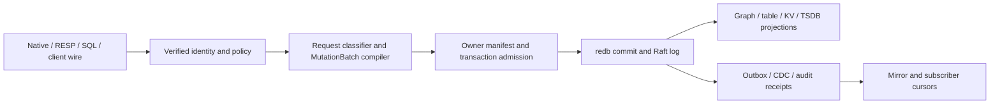

# Implementation plan

## Build sequence

1. **Baseline and proof harness.** Pin one main revision and inventory the listed entry points. Record existing focused and hosted gate results. Add reproducible fault/cluster fixtures. Mark each work ID as queued, built, landed, or accepted only from actual evidence.
2. **Transaction and storage authority (KG-01–04).** Add the cross-store ADR and enforce pre-effect refusal or atomic commit. Keep owner binding at the existing manifest/write boundary. Add lineage fixtures and bounded scrub. Verify table-only traffic stays in its present atomic path.
3. **Policy and audit (KG-07–09).** Thread the verified authority context through every native/read/wire path; cover foreign sources, UDFs, KV, TSDB and caches. Add reserved audit and lease kinds through the existing audit store and capability registry. Define generated client error codes before changing callers.
4. **Outbox, replication and mirrors (KG-05–06, KG-10).** Repair head attempts and replay; add per-consumer cursor/reconcile using committed ChangeEnvelope events. Add failure trace capture and repeated multi-node tests. Expand mirror sinks to user tables only after source/target digest and schema semantics are specified.
5. **Native performance (KG-11–15).** Make durability visible and measured, then add RAM working structures, batching and classification. Extend the existing dependency clock plan cache. Run store-engine ADR and benchmark matrix; publish precise per-workload results.

## Integration and migration

Persisted formats change only behind lineage versions and migration/rollback fixtures. Existing sync namespaces retain sync semantics until explicitly reconfigured. Existing client/wire methods continue to use the canonical MutationBatch path. Generated clients are regenerated from the authoritative protocol contract rather than hand edited. A mirror or replica is introduced in shadow mode, reconciled against source digest, then promoted by explicit operation. Restart resumes its cursor. If a new path lacks authorization or audit parity, it is not wired into serving.

## Definition of done

Each task names a `KG-*` requirement, tests its normal and refusal cases, and records exact revision plus CI links. `pre-commit run --config .config/pre-commit.yaml --all-files` and `bash scripts/ci_parity.sh` are the repository's broad configured checks; focused cargo tests and cloud CI are required for affected packages. CCCC, Dupehound, jscpd differential, KISS, rust architecture lint and clippy must have evidence at the same head. A missing scanner is a setup failure, not a pass. Live cluster/system proofs may add confidence but cannot replace reproducible container or process fixtures available to outside contributors.

No acceptance status changes until a reviewer can trace requirement → code entry point → positive/negative test → exact merged revision. Document only changed public wire contracts and operational behavior needed by contributors; generated documentation has its own source-of-truth workflow.

## Worker registry sequence

Implement R074.1 in eg-types with explicit caller-supplied timestamps and checked TTL arithmetic. Preserve capacity facts through heartbeat and expire at now >= deadline. Then R074.2 consumes that module through authenticated tenant/principal-scoped dispatch and regenerates contracts; verify the served path before completing the parent.

## Scheduler producer-first decomposition

R076 spans pure data and the served setting/admission boundary, so the SPEC-SIZING producer-first split is R076.1 followed by R076.2. Deliver and test the native `eg-types` contract first, then connect it to the engine with served tests. Keep the parent open until both children are met. No server or worker policy is changed by the first slice.

## Architecture

### Existing path to extend

`src/server/mutation_batch.rs` compiles and commits the request, `crates/eg-types/src/mutation_batch/` defines its persisted envelope, `crates/eg-transaction` admits it, `crates/eg-storage/src/owner/` binds a store owner, and `src/redb_store/` applies it. `src/raft/store/` handles replicated log/state-machine commits. `src/server/{auth,authority_context,sql_catalog_acl,kv,cdc}.rs` and the wire directories feed that same kernel. `crates/eg-tsdb/src/store.rs` and `crates/eg-stream/` are existing series and stream owners. These are extension points, not proposals to replace them.

No arrow bypasses identity, owner binding, or transaction admission. A native fast path may skip the SQL planner only. Derived hot structures and Parquet copies can be rebuilt from committed authority; they cannot accept independent authoritative writes.

### Stable interfaces

| Contract | Producer → consumer | Invariant |
|---|---|---|
| `MutationBatch` + terminal result | wire/compiler → transaction + redb/Raft | canonical request digest, verified scope, idempotency key, member set and one terminal outcome |
| `OwnerManifest` lineage | storage registry → loader/writer | version and member ownership checked on read; unsupported layout gives named refusal |
| `ChangeEnvelope` + position | committed stream → CDC subscriber | monotonic source position, replay-safe key, schema version, no uncommitted event |
| Audit reservation/outcome | effect caller → EG audit store | `PENDING` before effect; linked completed/failed/indeterminate result; no outcome forgery |
| Mirror cursor | committed stream → target sink | per-target durable checkpoint advanced only after idempotent target apply |
| Auth context | verified transport → all executors | tenant and principal survive every route; no caller-supplied scope substitution |

### Commit and recovery

Admission checks identity, scope, capability, owner member set, lineage, size and idempotency before opening a write transaction. For a single redb shard, graph and table members should share one redb `WriteTransaction`; if they cannot, an ADR must choose a recoverable intent protocol or a clear pre-effect refusal. A multi-shard/replicated batch must identify the commitment and replay boundary, preserve deterministic ordering, and return one terminal result after durable acknowledgement. Crash injection at before-admission, after-intent, after-member-write, before-seal, after-seal, before-reply and after-reply must yield only absent or fully committed state, with idempotent retry after lost acknowledgement.

Owner binding is validated once per write transaction and cached only for that transaction. A manifest format bump retains a golden fixture for each supported predecessor and a named refusal for unsupported lineage. A background scrub uses bounded read transactions, a persisted/resumable key cursor and a rate cap. It never repairs data silently. Typed findings include member, key digest, error class and first/last observed time without leaking payloads.

### Policy, audit and streaming

The transport verifies claims; all read executors and the native fast path take an immutable scoped authority context. RLS predicates apply before returning or joining user data. Explicit grants are resolved at use time, so revoke takes effect on the next request. KV keys retain principal-bound HMAC partitioning in every durability class. Audit reservation must be durable before any governed effect; an interrupted worker leaves `PENDING` for reconciliation, not a fabricated success. The outbox increments attempts for the head actually tried. Rejected reasoning projections require rebuild rather than skip-ack. CDC and mirror checkpoints move after target apply and can replay from the previous checkpoint safely. Delivery-side cursor rows stay local to their owner unless a versioned replicated contract proves otherwise.

The deployment may offer `none`, `local`, or `external` authentication, but all modes produce the same internal principal/RBAC context before dispatch. `none` is an explicit single-principal development mode and must not mint an administrative identity from a client-supplied name. `local` owns password/session lifecycle in EG; `external` validates issuer, audience, tenant and policy-version binding before mapping claims. Switching modes must not reinterpret an old session as another principal. Every mode uses the same scope checks, request digest, audit class and access-denied errors. JIT elevation is a separate reserved `rbac.elevation` lease: the proposer and approver are distinct verified principals, the digest is exact, expiry is checked on every use, and ordinary lease-write capability cannot issue it. Schema repair uses its own reserved kind with the same two-person invariant.

### Native storage expansion

Classify requests before planner allocation. Only an exact supported point/structure form takes the native route; ambiguous SQL stays in the SQL planner. Prepared SQL cache keys include statement digest, dialect, schema version, authorization scope and relevant dependency-clock generation. Schema or policy changes invalidate before reuse. `sync` is default and cannot be silently changed. `async` acknowledges within its advertised maximum loss window, exports observed oldest-unflushed age, and blocks/degrades explicitly if it cannot honor ≤100 ms. `ephemeral` is advertised as non-recoverable. Hot structures are reconstructed deterministically from the durability log; compaction and hot/cold union preserve tombstone/version order. The store-engine comparison is an ADR based on reproducible captured workload fixtures, not a second authority design.

### Cross-product boundaries

The [`unified-data-plane`](../unified-data-plane/spec.md) spec owns attached-source adapters, catalog mapping, upstream CDC capture, and federated query routing. It submits canonical envelopes and consumes EG positions. Serving products may call the audit API but cannot implement an independent audit log or skip reservation when unavailable. Finance can use TSDB and transactions, but this kernel contains no trading decision or order policy. These links are to local repository contracts; implementing this spec requires no private inventory.

### Design decisions to record before implementation

1. Cross-store atomicity ADR: same redb transaction versus recoverable intent versus bounded refusal, with measured failure matrix.
2. Native hot-store ADR: redb versus alternatives with persistence/latency/restore comparisons.
3. Durability-class wire contract: how class, measured loss window and failure state are exposed for each protocol.
4. Mirror/replication compatibility contract: schema evolution, ordering, cursor, restore and security behavior.

### Analytics worker carry-over

The agent-utilities analytics worker (removed in AU-SEMANTIC-R011.10) was a remote client of the engine's existing `eg-jobs` plane, not a separate queue. It opened one engine connection per slot with a service identity holding scopes `kg:write` and `analytics:worker`, claimed jobs with `worker_claim`, checkpointed at progress 0.1 and 0.9, stage-published a typed result and called `worker_publish`. It had no schedule: it polled. Schedules for analytics belong to `JobIntent` in `crates/eg-jobs`, which this spec does not change.

The engine already runs the same loop in-process (`ensure_job_workers`), so the owning process for mining is the engine. A second process only adds a network hop and a second copy of the kernel. If a remote worker is ever needed, graph-os hosts it (it deploys engine-adjacent services) and uses the generated client; agent-utilities does not. The generic task queue in `EG-DURABLE-KERNEL-R071` to `R077` serves other work and is not used by this path.

| Old entry point | New entry point | Status |
|---|---|---|
| console script `graph-os-analytics-worker` | colocated pool, `EG_ANALYTICS_WORKERS` | exists (R082.1) |
| payload decode and bounds | submit-time validation | exists, verify (R082.2, R082.3) |
| rule identity, result shape | `results_association.rs` | exists, verify (R082.4, R082.5, R082.6) |
| status polling, cancel, deadline, cpu budget | executor stop checks | exists, verify (R082.7) |
| `_slot` retry and reconnect | durable `RetryPolicy` backoff | exists, verify (R082.8) |
| slots, lease, poll environment settings | validated pool settings | to build (R082.9) |
| remote claim by capability | `JobsClient` worker operations | exists, verify (R082.10) |
| multi-endpoint reconnect cursor, signal handling, Python Eclat kernel | none | intentionally dropped: in-process execution needs none |

The mining submission boundary returns `INVALID_ARGUMENT` for non-finite or out-of-range thresholds, unsupported algorithms, and distinct-item overflow. Parameter checks run before input pseudonymization, and refusal details do not echo the supplied algorithm. Malformed transaction shapes are rejected during typed wire decoding. Default support (0.1), confidence (0.5), and algorithm (`fpgrowth`) remain unchanged.

Out of scope: new analytics families, a schedule for mining jobs, and any change to the task-queue rows. Not determinable from the deleted source: the engine kernel's own item cap (R082.3).

### Scheduler policy contract (R076.1)

`eg_types::scheduler_config::SchedulerConfig` is the sole producer of scheduler policy data: explicit total workers and queue depth, deterministic lane-floor map, CPU per-mille default 360, and memory-per-worker default 3,221,225,472 bytes. `validate()` rejects blank lane IDs, CPU fractions above 1000, zero memory divisors and floor sums exceeding the pool. Checked subtraction prevents floor-sum overflow. Zero pool, CPU fraction or queue depth is an explicit disabled resource; the later grant path must never override it with a floor of one. Serde rejects unknown fields and requires the two explicit limits. Deserialization alone is not policy admission: consumers must call validation before applying data.

R076.2 remains responsible for scope, persistence, served reads/updates, lane membership and real admission/queue enforcement. Worker registration supplies capacity, not an alternative policy authority. R074 worker registration and these floor keys share canonical engine lane IDs; served integration must validate membership against the same registry.

## Lifecycle control admission and fixture isolation

The control owner must bind each R049 maintenance claim to its in-transaction version.
The graph owner must retain caller-key replay and nonce enforcement.
`delete_purges_receipts_of_a_prior_incarnation` must prove recreation and subsequent replay across restart.
The shared temporary-path helper must add a process-local sequence; concurrent path tests must prove uniqueness.
Native facade acceptance remains pending.

## Clippy profile declaration coverage

R011.5 checks both required Clippy profiles through the existing release feature-matrix suite.
The R011 parent binding records partial declaration coverage only.
R011.3 and R011.4 retain their runtime and exact-head receipt obligations.
The generator must keep these three rows SPECIFIED until their own evidence exists.

## Amendments

### 2026-10-11: R082.6 historical ordering

EG-DURABLE-KERNEL-R082.6 previously left ascending tie keys ambiguous.
The historical miner sorts first-seen integer IDs, not label strings.
The engine must preserve this order.
AU commit `134576bd0f5931a9b22ed3c3859a3f4350731ad6` provides the original implementation.
Commit `92974bae8c3ed3a270f582300b7458d4f53571c4` deletes that implementation.
The fixture records unchanged historical mining definitions, executed without unrelated transport imports.
Six transactions use reverse-lexical labels and duplicate items.
The existing association module owns execution; its child test module owns parity checks.
No second production miner is introduced.

### 2026-10-11: R011 and R014 runtime acceptance repair

This amendment applies to EG-DURABLE-KERNEL-R011 and EG-DURABLE-KERNEL-R014.
Previously, each generated parent inherited completion from its sole typed-model child.
The parent text and source comments explicitly deferred runtime work.
Now, R011.2 through R011.4 track the manifest, pre-merge execution, and exact-head CI receipts.
R014.2 through R014.5 track load generation, repeated execution, and both cluster-test acceptance records.
The existing children retain their evidence. The original runtime obligations remain mandatory.
The repair extends existing parents because both parents already own these behaviors.
Planned children record unverified acceptance; they do not imply that every implementation is absent.

## Audit record

2026-10-11: R082.6 compares all three engines against the historical Python output.
The fixture records source identity and SHA-256.
Boundary cases cover ceiling support, minimum count, confidence tolerance, and zero consequent support.

### 2026-10-11: runtime source audit

Audited revision: `2a2f9498863250c71827cf56ecbcb9307940cff0`.
`crates/eg-types/src/pre_merge_test_module.rs` explicitly defers the concrete manifest and pre-merge gate.
`.github/workflows/release.yml` excludes `gates-variants` from pull requests.
The same workflow declares `published-full` and `workspace-all-features` clippy profiles with Kafka dependencies.
Configuration presence does not supply passing exact-head CI receipts.
`src/raft/flake_budget.rs` explicitly defers the representative-load generator and repeated-run harness.
`scripts/validate-raft-cluster.sh` selects leader rebalance but omits the named placement-admin test.
That script records no representative-load generator or repeated-load evidence.
`src/raft/tests.rs` contains both named cluster tests.
`src/raft/harness/trace_capture.rs` owns existing causal trace capture.
No runtime suite ran during this spec-only repair.

### 2026-10-11: concrete runtime manifest

R011.2 extends `RequiredTestModule` with explicit features and Cargo arguments.
The manifest selects real library-test modules in the engine and transaction crate.
`validate_selection` refuses an empty or mismatched discovery inventory.
Eight source-module tests passed with Rust 1.96.0, including source-anchor checks.
This evidence completes the manifest child only. R011, R011.3, and R011.4 remain open.

### 2026-10-11: bounded representative CPU load

R014.2 extends the existing cluster validation script with explicit opt-in CPU load.
`RAFT_LOAD_WORKERS` accepts 1 through 32; `RAFT_LOAD_SECONDS` accepts 1 through
3600 seconds, default 300. Invalid settings refuse before compilation.
Workers begin only after the build and remain active during the test command.
The supervisor aborts on budget exhaustion or unexpected worker exit and reaps
workers and the command process group on success, failure, SIGINT, or SIGTERM.
The supervisor logs worker count, process IDs, duration bound, and measured elapsed time.
Unconfigured callers keep the existing unloaded command. R014.3 through R014.5
remain open: process-fixture tests do not prove loaded Rust cluster acceptance.

### 2026-10-11: make manifest reproduction portable

R011.2 reproduction writes its disposable binary beneath the checkout's target directory.
The public-spec gate and its regression test must reject machine-specific paths.
This documentation repair adds no Rust execution evidence or runtime acceptance.

### 2026-10-11: repeated loaded harness

R014.3.1 adds bounded repetitions and per-invocation evidence to the existing CPU-load supervisor. R014.3.2 retains Rust FlakeBudget-driven diagnostic retries. R014.4 and R014.5 remain open until actual Rust cluster execution is recorded.
