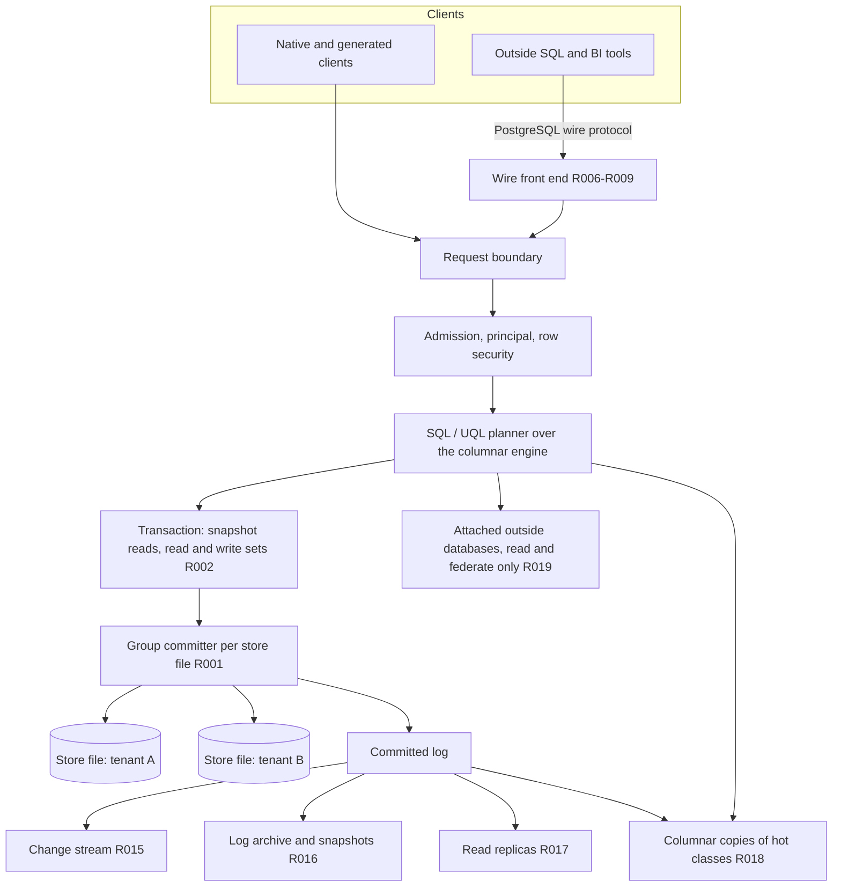

# EG-ENGINE-PARITY plan

Governing spec: [spec.md](spec.md).
Code: ../../src/server/pgwire/mod.rs ../../src/server/pgwire/auth.rs ../../src/server/sql_wire_auth.rs

## The trade-off

The engine stays one library. That choice keeps five properties that a second engine breaks.

- **One library.** One process, one commit path, one backup. No network hop inside a commit.
- **Deterministic replay.** Every state derives from the committed log. Decisions replay byte for byte.
- **Sealed records.** Create-only classes (EG-DURABLE-KERNEL-R057) hold in one store with one guard.
- **Epistemic and ontology primitives.** Trust, provenance, bitemporal reads and OWL reasoning sit in the same transaction as the data.
- **Embedded targets.** The same library runs on a small board and in the cluster.

The cost is maturity work. A mature relational database brings decades of planner tuning,
index kinds, constraint semantics, tool compatibility and operations practice. This spec builds
that parity piece by piece, only for named consumers. It states each gap in the compatibility
matrix (R009) instead of hiding it.

## Architecture

Every arrow stays inside the library except the wire listener, the archive target and the
attached sources. No arrow writes engine data to an outside database.

## Write concurrency

| Mechanism | Row | Effect |
|---|---|---|
| Group commit | R001 | One write transaction and one fsync per batch of up to `max_batch` requests |
| Optimistic concurrency | R002 | Snapshot reads; read and write sets validated at commit; typed conflict |
| Partitioned store files | R003 | One committer per tenant or declared partition; partitions commit in parallel |
| Disjoint acceptance | R004 | Non-overlapping footprints never wait; shared with EG-SCM-R003 |

A batch over two partitions uses the cross-store path of EG-DURABLE-KERNEL-R034 or refuses.

## PostgreSQL wire front end

The listener already exists in `src/server/pgwire`. It has TLS startup policy, `CopyState`
and an extended-query path. This spec completes the message flows (R006). It maps logins to
engine principals and row security (R007). It emulates the catalog views that tools read at
connect (R008). It publishes the dialect matrix (R009). EG-DURABLE-KERNEL-R035 keeps the
operational surfaces.

## Relational features

| Feature | Row | Engine form |
|---|---|---|
| Secondary, partial, expression indexes | R010 | redb index tables updated in the row transaction |
| Unique, foreign key, check, not null | R011 | Commit-time checks; SHACL shapes for graph data |
| Triggers | R012 | Reactive rules on the statechart engine, inside the transaction |
| Sequences | R013 | Block-reserved counters that never repeat after a crash |
| Views and materialized views | R014 | Stored plans; materialized views as derived series with lineage |

## Log-based services

The committed log is the one change stream. Change capture (R015), point-in-time recovery
(R016) and read replicas (R017) all read it. Columnar copies (R018) rebuild from it.

## Native modality map

Plan-level map only. The spec rows name capabilities, not extensions.

| Engine crate | Capability | Matching PostgreSQL extension class |
|---|---|---|
| `eg-ann` | Vector similarity search | vector similarity extension |
| `eg-geo` | Geometry types and spatial predicates | geospatial extension |
| graph kernels in `eg-core`, `eg-compute` | Property graph, traversal, openCypher-style queries | graph query extension |
| `eg-text` | Ranked full-text search | BM25 full-text extension |
| `eg-tsdb` | Time-series buckets and rollups | time-series extension |
| `eg-viz-columnstore`, Parquet through the columnar engine | Columnar storage and scans | columnar storage extension |

## Failure modes

| Failure | Detection | Behavior |
|---|---|---|
| Commit queue full | Bounded channel full | Refuse with `COMMIT_QUEUE_FULL`; the client retries |
| Write conflict | Footprint validation | Refuse with `TXN_CONFLICT{keys}`; nothing written |
| fsync failure | Store error on commit | Refuse the whole batch; the store re-opens read-only until an operator checks the disk |
| Partition file corruption | Scrub of EG-DURABLE-KERNEL-R020 | Isolate the partition; restore it by R016; other partitions keep serving |
| Change subscriber too slow | Cursor below the retained log | Refuse with `CHANGE_CURSOR_EXPIRED`; the subscriber re-snapshots |
| Replica behind | `applied_seq` below the token | Wait up to 2,000 ms, then refuse with `REPLICA_BEHIND` |
| Unsupported SQL form | Matrix lookup | Refuse with SQLSTATE `0A000` and the matrix entry |
| Wire client without TLS on a public address | Startup policy | Refuse to start the listener |

## Benchmark budget

| Workload | Budget |
|---|---|
| Single-row commit | p99 under 2 ms |
| 64 concurrent writers, one file | at least 20,000 commits per second; p99 under 5 ms |
| 8 partitions, 8 writers each | at least 6 times one file |
| Index probe on a non-key column, 10M rows | p99 under 2 ms |
| Prepared point read over the wire | p99 under 1 ms on loopback |
| 100M-row aggregate on a columnar copy | at least 5 times faster than the primary store |
| Change decoding at 20,000 commits per second | lag p99 under 100 ms |
| Replica lag under the 64-writer load | p99 under 200 ms |
| Restore drill, 10 GiB | under 15 minutes, zero lost sequences |

These budgets are starting defaults. A measured run of R005 and R020 replaces each one.

## Consumers

| Rollups | Named consumer |
|---|---|
| R001 to R005 | Concurrent agent writes through arbora; EG-SCM changeset acceptance |
| R006 to R009 | Outside BI and SQL tools for the catalog and governance rows; the native-hosting pilot of EG-UNIFIED-DATA-PLANE-R026 |
| R010 to R014 | Native-hosted application tables of EG-UNIFIED-DATA-PLANE-R024 |
| R015 to R017 | Change subscribers of EG-UNIFIED-DATA-PLANE-R009; operator recovery; read scale |
| R018 | Catalog profiling and quality jobs of EG-UNIFIED-DATA-PLANE-R761 and R762 |
| R019 | Every attached-source adapter |
| R020 | The benchmark gate of EG-DURABLE-KERNEL-R042 |

## Build sequence

1. R001, R002, R004, R005: write path and its benchmark.
2. R006 to R009: wire front end for the first outside tool.
3. R010, R011, R013: indexes, constraints and sequences for the first native-hosted application.
4. R015 to R017: log services.
5. R003, R012, R014, R018: partitions, triggers, views and columnar copies, each on demand.
6. R019 and R020 hold from the first step as boundary and report rows.
