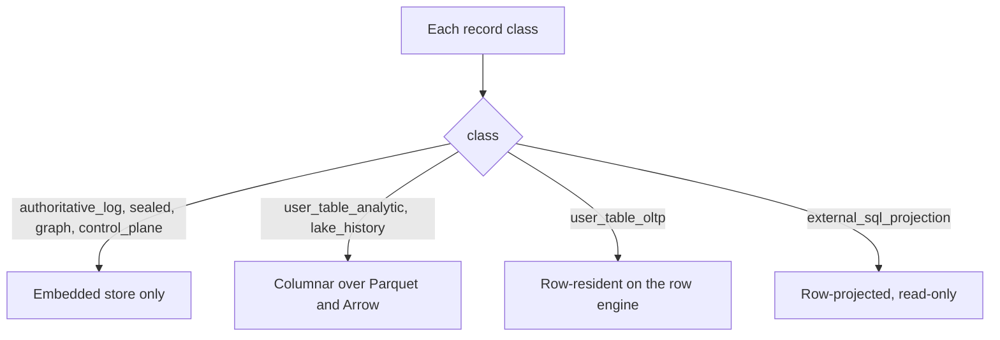

# EG-HYBRID-STORAGE plan

Governing spec: [spec.md](spec.md).

## Architecture

One authority, three storage engines, one fence.

- **Authority (unchanged):** engine admission, the table catalog and the commit sequence. Also the outbox committed stream, owner-store lineage and raft replication of owner state.
- **Embedded store (existing):** the redb stores. They hold the log, sealed classes, the graph and the control plane.
- **Columnar engine (existing):** the DataFusion session over the redb `TableStore`, the graph view and the `eg-lake` providers.
- **Row engine (new):** PostgreSQL behind a `RowDriver` trait in the new crate `crates/eg-rowstore`. The feature flag is `row-backend`.
- **Router (new):** plan-level, pure and deterministic. It caches decisions in the plan cache and adds a receipt to each result.

```text
        wire listeners (native / RESP / SQL wire)
        WorkloadClass + DispatchRoute gate          (existing, extended by R011)
                        |
                        v
        plan-level router  (R002)                placement lookup (R003, R014)
                        |
   +--------------------+-----------------+
   v                    v                 v
 columnar             row engine         federated (one fence, R005, R016)
 (DataFusion)        (RowDriver, R004)    (both engines, one commit position)
   ^                    ^
   |   engine commit kernel: admission, commit sequence, owner write,
   |   outbox envelope, reconcile  (existing; R004, R005, R007, R012, R015)
```

## Reuse (inventory before new components)

| Need | Existing owner |
|---|---|
| Durable user-table store and constraints | redb `TableStore` (`crates/eg-query/src/tables/store.rs`) |
| DDL classification and catalog admission | `crates/eg-query/src/sql/classify.rs` |
| Point and structure fast path | `WorkloadClass` and `DispatchRoute` (EG-DURABLE-KERNEL-R037) |
| Plan cache by statement digest and schema version | EG-DURABLE-KERNEL-R041 |
| Commit-before-ack durability and durability classes | EG-DURABLE-KERNEL-R038 |
| Cross-store scope classification | EG-DURABLE-KERNEL-R034.1 |
| Committed-only stream with per-consumer cursor | outbox and mirror contract (EG-DURABLE-KERNEL-R001, R002, R036.1) |
| Table providers for attached tables | EG-UNIFIED-DATA-PLANE-R007 |
| Shared SQL pushdown renderer | EG-FEDERATED-QUERY-R069 |
| Pending-method declaration before handlers | `src/server/contract_wave.rs` |

New components: `crates/eg-rowstore`, the typed models in `crates/eg-types`, the router, the
placement records, the fence and reconcile, and the new served methods. The design adds no
consensus layer, no outbox table, no second write authority and no raft log change.

## Interfaces

Wire surface at the request boundary. Generated clients follow. All changes are additive.

- `PlaceTablePlacement { tenant, graph, table, placement_class, driver_id? }` returns a placement receipt.
- `GetTablePlacement` and `ListTablePlacements` return placement records.
- `RowBackendStatus` returns the fence, the applied digest, the negotiated capabilities and the contract comparison.
- `ExplainRoute` returns the router decision for a statement without a side effect.
- `QueryResult` gains an optional `routed_to` receipt and an optional `ConsistencyToken`.
- A new storage-admin scope guards placement operations.

Internal seams, not on the wire:

- `RowDriver`: pool, begin, commit, rollback, `fence_inject`, index DDL, `digest_scan` and `bounded_scan`.
- `RowTableStore`: the logical operation set of the redb `TableStore`.
- Fence record `(published_commit_seq, published_at, applied_set_digest)`. Row-visible rows are a subset of engine-committed rows.

## Live wiring

- Placement admin dispatches through the request boundary. The placement record commits in the catalog owner write.
- The router sits after table resolution in the SQL and UQL path. The `WorkloadClass` gate runs first.
- Row-resident writes enter the admission and commit protocol. The row transaction is one participant.
- The projection consumer registers as a mirror target with a per-table cursor.
- The new methods start as pending declarations in `src/server/contract_wave.rs`. Each declaration stays until its handler lands.

## Decisions

- **In-authority placement.** Foreign sources stay read-only. Mirrors stay read-only. The row engine is a third category.
- **Plan-level routing.** Only the plan holds placement, shape and cardinality. The columnar path is the last fallback.
- **The fence is the consistency contract.** The injection method is a driver choice behind the trait.
- **Mixed batches refuse before effect** until the cross-store decision of EG-DURABLE-KERNEL-R034 lands with fault proof.
- **Graph and control plane stay engine-only** by the closed taxonomy of R001 and the policy of R014.

## Build sequence

Each phase starts only after the previous phase shows its evidence in generated status.

1. **P0, typed models:** R001, R011, R013, R014. No behavior change.
2. **P1, placement, projection and fence:** R003, R005, R007, R015.
3. **P2, routed reads:** R002, R008, R009, R016, R017.
4. **P3, routed writes:** R004, R006.
5. **P4, mixed batches:** R012.
6. **P5, operations:** R010, R018, R019, R020.

## Dual-engine design (R013 to R020)

This section completes the design for three storage engines under one authority. It names
each engine as a component of this platform.

### Engine assessment

The table states where each engine is strong and weak today. The columnar engine is already
vectorized over Arrow batches. The gap is not scan speed. The gap is concurrent row writes,
maintained indexes and outside-tool access.

| Property | Embedded transactional store (redb) | Columnar engine (DataFusion over Arrow and Parquet) | Row engine (PostgreSQL) |
|---|---|---|---|
| Write concurrency | One writer per store. Group commit batches writes. | Not a write engine. It reads committed batches. | Concurrent writers under mature MVCC. R019 measures 64 writers. |
| Point read latency | Lowest. In-process B-tree with no network hop. | Higher. Each statement pays plan and session cost. | Low with an index. One network hop. |
| Large analytical scan | Row at a time. Weak. | Strongest. Vectorized batches, column pruning and predicate pushdown into Parquet. | Row-oriented heap. Weaker on wide scans. Parallel scan narrows the gap. |
| Secondary indexes | Hand-built per table. No partial or expression index. | None maintained. Pruning uses file statistics only. | B-tree, hash, inverted, generalized search and block-range indexes. Partial and expression indexes. |
| Constraints and triggers | Engine-coded checks only | None | Full SQL constraints, deferred checks and triggers |
| Extensions | None | User-defined functions in process | Vector, full-text, geospatial and graph extensions |
| Change capture | Committed outbox stream of the engine | Not applicable | Logical replication and decoding |
| Outside BI tools | Only through the engine wire listeners | Only through the engine | Native wire protocol; every SQL tool connects |
| Operations maturity | Owned by this team; small surface | Library inside the engine | Decades of backup, restore, replication and tooling |
| Failure blast radius | Inside the engine process | Inside the engine process | Separate process; network and credential failures appear |

### Placement policy



| Record class | Placement | Reason |
|---|---|---|
| Authoritative log, commit sequence, outbox | Embedded only | One commit authority; no network in the commit path |
| Sealed records (blobs, verdicts, releases) | Embedded only | Create-only guard of EG-DURABLE-KERNEL-R057 |
| Graph nodes, edges, ontology | Embedded only | Graph kernels read in process |
| Control plane (identity, grants, leases) | Embedded only | Admission must not depend on a second process |
| Analytic user tables, history | Columnar | Vectorized scans over Parquet |
| High-concurrency user tables | Row-resident | MVCC writers, maintained indexes, constraints |
| Tables for outside SQL tools | Row-projected | Wire compatibility without a second authority |

### Commit and consistency

```text
client write
  -> engine admission (identity, scope, idempotency)
  -> engine commit: assign commit_seq; write commit record + outbox envelope   [one embedded txn]
  -> row participant: apply_committed(envelope) in one row txn; set applied_seq; inject fence
  -> ack with ConsistencyToken{commit_seq}
reader with token
  -> router: fence >= commit_seq ? route row : wait <= 2,000 ms : else columnar + degraded marker
replay
  -> outbox cursor from the last fence; apply_committed is a no-op at or below applied_seq
```

The engine is the single commit authority. The row engine never accepts a write that the
engine did not commit. Row-engine logical replication is an outbound feed for outside
consumers only. It never feeds back into the engine.

### Federated plans

The columnar engine plans every mixed statement. A row table is one table provider. The
provider pushes filters, projections, limits, aggregates and joins between row tables. The
columnar engine runs the rest. Both sides read at one fence position.

### Tenancy and row security

| Engine concept | Row-engine object |
|---|---|
| Tenant | One schema per tenant |
| Engine principal class | One role with no login, granted per schema |
| Tenant and clearance predicates | One row policy per table, forced on, default deny |
| Outside reader identity | One read-only login role per identity, issued by arbora |
| Masking policy (EG-FEDERATED-QUERY-R706) | A view per masked table; the base table is not granted |

### Backup, restore and migration

- One backup pins one fence position across both engines.
- The row engine keeps a base backup plus a continuous write-ahead log archive.
- Restore order: engine snapshot, row base, log replay to the fence, then committed-stream replay.
- A lost row engine rebuilds from the engine by R008 backfill. The engine stays the source.
- Placement migration in both directions is one catalog write after a copy with equal digests.

### Failure modes

| Failure | Detection | Behavior |
|---|---|---|
| Row engine down | Probe failure; driver error | Reads degrade to columnar with a marker (R010); row writes refuse per durability class |
| Row engine behind the fence | `applied_seq` below `commit_seq` | Token reads wait up to 2,000 ms, then degrade |
| Crash between engine commit and row apply | Fence below the outbox head at boot | Replay from the cursor. Apply is idempotent (R015). |
| Schema drift in the row engine | Catalog digest mismatch at open | Stop row routing for the table; reconcile first |
| Row-policy drift | Policy digest mismatch | Stop row routing for the table (R017) |
| Credential failure | Open refusal | Provider `unready`; no routing (R020) |
| Split brain after a manual promote | Two instances report one provider id | Refuse open on the second instance. The operator picks one. |
| Disk full on the row engine | Write error | Refuse the row write; the engine commit stays authoritative; backfill later |

### Performance budget

| Workload | Placement under test | Budget |
|---|---|---|
| Point write, single row | Embedded vs row-resident | Embedded p99 under 2 ms; row-resident p99 under 6 ms |
| 64 concurrent writers, disjoint rows | Embedded vs row-resident | Row-resident throughput at least 3 times embedded |
| Index probe on a non-key column | Columnar vs row-resident | Row-resident p99 under 3 ms at 10M rows |
| Partial-index probe | Row-resident | p99 under 3 ms |
| Full scan and aggregate, 100M rows | Columnar vs row-resident | Columnar at least 5 times faster |
| Mixed join, 1M lake rows with 10,000 row rows | Federated | p99 under 400 ms |
| Token read after write | Row-resident | Added p99 under 1 ms with a current fence |
| Outside SQL tool read, 1,000 rows | Row-projected | p99 under 20 ms |

These budgets are starting defaults. A measured run of R019 on this platform replaces each one.

### Deployment

The row engine runs as one stateful workload in the platform cluster. It uses the platform
PostgreSQL image with the vector, full-text and graph extensions. It pins one node with a
local volume. A streaming standby on a second node serves as read replica and failover
target. Credentials come from the platform secret store through an external-secret
resource. Readiness uses the R020 probe. The engine reads `contract/row_engine.json`; the
platform manifests satisfy it. Failover is manual and gated by an operator.
