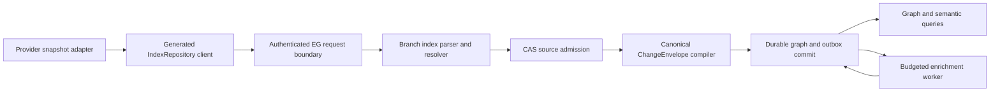

# EG-REPO-INGEST implementation plan

Governing outcome: [spec.md](spec.md). Normative data and failure contract: [architecture.md](plan.md).

## Existing implementation to extend

The generated/public shapes are `crates/eg-types/src/ingestion_wire.rs` and `epistemic_graph/generated/index_repository.py`. The native parser and branch projection live in `crates/eg-compute/src/parser/branch_index.rs`. `src/server/dispatch/graph_pipeline/repository_index.rs` applies graph scope and ACL, parses off the reactor, admits source bytes and calls `src/server/handlers/repository_index.rs`. That handler lowers to a canonical write set and one `ChangeEnvelope`, with current `REPOSITORY_BATCH_TOO_LARGE` budgeting. `src/server/repository_enrichment_worker.rs` and its dispatch consumer are the existing durable work path. `src/server/handlers/source_ingestion.rs`, `crates/eg-types/src/source_ingestion.rs` and `docs/architecture/source_ingestion.md` implement the general source contract. These are the owners to reuse, not templates for a second service.

Current evidence includes branch-aware durable tests in `tests/repository_index_durable.rs`, parser tests in `crates/eg-compute/src/parser/branch_index_tests.rs`, generated result contract tests, and source-ingest tests. They establish parts of RI-01–RI-06 and RI-11. They do not prove full semantic bridge coverage, all failure reparse behavior, production throughput, or an accepted release. The implementation must inspect the exact current revision before claiming a gap is still present.

## Sequenced changes

1. **Freeze the contract.** Confirm generated `IndexRepository` and `SourceIngest` schemas, stable parse-disposition and refusal codes, bounds and feature-gating. Add contract fixtures for each error and parser outcome. Regenerate clients from authoritative schema; never hand-edit generated bindings.
2. **Complete identity and scope.** Canonicalize repository, revision, path, blob, file-version and per-occurrence symbol identities. Validate duplicate/conflicting membership and tombstones before CAS admission. Resolve the multiple-edge representation decision in [architecture.md](plan.md) with a regression.
3. **Complete parser and resolver.** Make per-file outcomes exact and repeatable. Preserve failed/unsupported blobs for capability-version reparse. Resolve cross-file calls/imports by scope and stable order; annotate unresolved cases; commit only admitted endpoints. Implement deterministic, versioned model-free similarity.
4. **Complete one-writer projection.** Extend `repository_index` lowering and `ChangeEnvelope` metadata with source/lineage and semantic-bridge relations. Keep CAS holder, graph projection, tombstone and outbox behavior atomic at the graph commit boundary. Retire any alternate graph mutation path after its callers use this path.
5. **Complete bounded enrichment.** Use the existing mutation outbox and worker; add admission and budget receipts, fenced retry/park and a bounded on-demand path. Native indexing must return without waiting for model work.
6. **Complete source-position consumers.** Extend approved `SourceIngest` mappings with idempotent graph/index/outbox projection and a Debezium-style envelope adapter. Preserve source position and explicit deletion. Implement bounded freshness wait and route evidence for accelerated reads.
7. **Prove integration and release.** Run the [test matrix](test-spec.md) on public fixtures, a fresh store and a restarted store. Publish exact commit, generated artifact digest, test command/result and benchmark environment in a local `evidence.md` when complete. Update this spec's delivery and acceptance independently.

## Interfaces and compatibility

Keep the existing `Method::IndexRepository { files_msgpack, scope }` entrypoint and typed `IndexResult`; add fields with explicit schema evolution and generated-client round trips. A caller can submit smaller batches on `REPOSITORY_BATCH_TOO_LARGE` without changing identity or replay semantics. Existing graph data may need a versioned re-index if symbol or file-version IDs change; never reinterpret persisted old IDs silently. New metadata must be optional or migrated with a tested one-time upgrade. Source-ingest checkpoint CAS is not relaxed for connector retries.

## Quality gates

Run focused parser, durable repository, source-ingest, generated-client and restart tests during development. Before landing code, use `pre-commit run --config .config/pre-commit.yaml --all-files` and `bash scripts/ci_parity.sh` where the environment supports the hosted matrix. Report any unrun service matrix separately. The repository's configured changed-code CCCC gate is `python3 scripts/check_complexity_staged.py` (no new cyclomatic over 10 or cognitive over 15). Dupehound is `python3 scripts/check_dupehound.py`. KISS is `bash scripts/check_kiss_staged.sh`. Jscpd differential is `python3 scripts/check_duplication.py enforce --base-ref <merge-base>` with the repository's scanner contract. The manual whole-tree CCCC census and jscpd census are defined in `.config/pre-commit.yaml`. Use those configured thresholds, not a fabricated score. Fix duplicate owner logic at the source. Do not suppress a legitimate finding or split a function solely to pacify a scanner.

The deterministic contract/unit tier must run from a clean checkout with local toolchain and temporary storage. Tests requiring a provider, model, cluster or credentials belong to an explicit opt-in served tier with a reproducible provision step. A missing live service cannot fail the offline contribution gate.

## Architecture

This document defines the engine-owned boundary and data model for [spec.md](spec.md).

### Authority and flow

The adapter is transport only. EG verifies graph write access before invoking parser work. The request boundary validates a portable repository-relative path, digest spelling, bounded scope, and feature availability. Parse and projection run off the network reactor. CAS admission can precede the graph transaction; a CAS holder has no graph visibility until the one envelope commits. The envelope is the sole graph writer for this path. The response is emitted after the commit, or on exact digest replay after reading its durable receipt.

`SourceIngest` is the parallel entrypoint for governed connector observations. It uses approved manifest mapping references, EG-computed live-set differences and the same `ChangeEnvelope` commit authority. A source-position bridge or index update is a consumer of that committed envelope, keyed by tenant, source ID, partition and position; it cannot reimplement graph mutation outside the envelope path.

### Entity and identity model

| Entity | Identity | Required durable fields |
|---|---|---|
| Repository | verified tenant + canonical repository ID | source kind, schema version, access class |
| Ref | repository + ref name | status and immutable current revision ID |
| Revision | repository + canonical immutable commit ID | parent IDs if supplied, observed time, evidence digest |
| Blob | content SHA-256 (stored under tenant/repository holder) | content reference, length, parser capability digest, parse disposition |
| FileVersion | repository + revision + normalized relative path + blob digest | path, blob link, validity and provenance |
| SymbolOccurrence | FileVersion + byte start/end + symbol kind + disambiguator | declaration name, language, span, parse evidence |
| Resolved edge | relation + source occurrence + target occurrence + algorithm/schema version | provenance, confidence when statistical |
| Work item | snapshot digest + enrichment kind + policy/admission version | budget, attempt, lease, state, output receipt |

Never key an occurrence solely by source text or blob digest: one blob can be mounted at different paths and refs, and identical declarations can appear twice. Branch membership is a relation to an immutable `FileVersion`; removing membership does not delete another ref's graph. Ref names can move, commit IDs cannot. Exact path normalization rejects absolute paths, traversal and URI-like host paths. Hash digests use lowercase `sha256:<64 hex>`.

The parser outcome is one `IndexFileOutcome` per submitted unique blob, preserving order. `success`, `unsupported` and `error` are distinct. A parse capability digest identifies the parser grammar/configuration so a later capability revision can retry failed/unsupported material without changing the immutable source digest. Diagnostics are bounded and machine readable. Rung evidence is derived inside EG and is not trusted from the request.

### Symbol resolution and semantic bridge

Parsing first produces file-local declarations and unresolved references. A deterministic second pass builds lookup indexes by language, module path, scope, exported name and arity. It resolves within the admitted snapshot, prioritizes exact receiver/import scope, and records ambiguity or external-package references as unresolved counts. Candidate ordering is canonical; neither filesystem enumeration nor hash-map order changes the result. Statistical `similar_to` edges require a versioned algorithm, score threshold, deterministic tie-break and provenance. An inferred target must already be an admitted node. `depends_on` connects actual source file versions, never raw import strings.

The semantic bridge projects typed relations for `declares`, `calls`, `inherits`, `realizes`, `depends_on`, `definedBy`, `testedBy`, `specifiedBy` and `releasedIn`. All relations point to stable graph IDs and carry the source evidence digest plus projection schema version. A spec, test or release artifact can enter only through authenticated source indexing or another approved ingestion contract. A missing target is recorded as unresolved rather than fabricated. Query permissions are evaluated before returning content or provenance. Bridge projection shares the envelope writer and tombstone rules.

### Atomicity, replay and recovery

Lowering canonicalizes properties and graph methods, validates the complete operation and MessagePack item/byte budget, and hashes the lowered write set. The envelope includes policy and privacy attestation, source references, provenance, tombstones and optional outbox intent. The graph version, projection, cursor/marker and receipt commit together. Identical request digests replay; same external id with different content is a conflict. Over-limit requests return `REPOSITORY_BATCH_TOO_LARGE` before graph commit. A client may split the batch; each split remains independently atomic and converges to the same final graph.

A restart reads the committed envelope and source marker from durable storage. Incomplete CAS admission is recoverable or garbage-collectable by holder policy but never advertised as indexed. Outbox leases are durable and fenced; a worker may reattempt after crash without duplicating a completed result. With replication enabled, write and worker submission require current placement/leader authority. An unsupported feature build returns a stable feature refusal; it cannot return a success shaped like an empty index.

### Security and operational decisions

- The verified request identity sets tenant and graph. A repository ID in payload is an identifier inside that authority, not an authorization credential.
- Preserve useful code text while replacing host identity in materialized properties. Raw bytes are tenant-scoped in CAS and subject to the graph's read policy.
- No live provider, credential, local inventory or model endpoint is needed for unit/contract tests. Provider adapters must supply their own reproducible fixtures.
- The native commit path is independent of enrichment. The worker uses engine-controlled admission, budget, grant and retry policy; model failure cannot roll back an already accepted native snapshot.
- Reuse the existing graph ACL, CAS, `ChangeEnvelope`, mutation outbox and generated contract mechanisms. New parser or projection abstractions need a demonstrated gap and a caller through the real service route.

### Recorded design decision: edge identity is the `(source, target, relation_type)` triple

The graph previously keyed some edges by endpoint pair alone, so multiple relation types between the same two endpoints had no canonical representation. Decided (operator-approved, EG-REPO-INGEST-R009.1/R009.2): an edge's identity is the triple `(source_id, target_id, relation_type)`, not the bare `(source_id, target_id)` pair. An untyped legacy edge migrates deterministically by reading its stored blob's `type`/`label` field as `relation_type`, falling back to `related_to` when neither is present; a migration collision (two untyped edges landing on the same triple) is resolved by a deterministic collapse rule and recorded in a collision receipt rather than silently dropped. The semantic bridge's nine relations (`declares`, `calls`, `inherits`, `realizes`, `depends_on`, `definedBy`, `testedBy`, `specifiedBy`, `releasedIn`) each project onto their own typed triple between the same two endpoints, so they never collide with each other or with an untyped edge.

Rejected alternatives:

- **Priority rule.** Pick one relation type to "win" per endpoint pair by a fixed precedence order. Rejected: it is not a representation at all — every lower-priority relation between the same two endpoints is unrepresentable the moment a higher-priority one exists, which is exactly the silent-drop failure mode this decision exists to close.
- **Set-of-types on one edge.** Keep one edge per endpoint pair and widen its `relation_type` field to a set. Rejected: it collapses distinct relations' independent properties, provenance and lifecycle (add/remove/invalidate timing) onto one shared record, and a removal of one type cannot be expressed without either deleting the whole edge or mutating the set in place with no edge-level audit trail.
- **Reified relation nodes.** Model each relation as its own graph node with edges to its source and target. Rejected: it multiplies node count by the relation volume, forces every relation-aware query through an extra hop, and provides no benefit over a typed edge for a binary relation that carries no further relations of its own.

## Amendments

### 2026-10-11: correct acceptance-evidence scope

Audit of revision `660ae016` found that the bindings for
`EG-REPO-INGEST-R003.1`–`EG-REPO-INGEST-R003.11` identified typed enum
serialization and local claim-list checks in
`crates/eg-types/src/source_ingestion/tests.rs`. These remain useful
supplementary unit evidence, but do not execute the migrated capabilities or
prove that their legacy modules no longer perform the same computation.
The child acceptance and therefore the R003 rollup remain unverified by this
evidence. Reopening T1 and T1a–T1k records that proof gap, not a conclusion that
all implementation is absent.

The R008-bound test in `src/server/handlers/repository_index_tests.rs` constructs
roughly 60 MB of payload, exceeds the 48 MiB write-set ceiling, and invokes
`lower()` on the full and halved fixtures. It proves the stable refusal prefix
and successful lowering of the smaller fixture. It does not exercise a batch
above 64 MiB through a served request, graph commit, or SDK halve-and-resend
retry. T2 remains open for that integration proof; its already established
contract and lowering checks remain supplementary evidence.

Remove full-acceptance bindings from these unchanged test bodies and regenerate
status with the official spec hooks. Preserve every normative requirement and
all existing implementation. Historical landing trailers remain historical
implementation evidence; a generated LANDED state without `verified_by` does
not establish acceptance. Full acceptance still requires the consumer/retirement
and served boundary evidence specified in requirements.md and test-spec.md.

<!-- spec-definition-patch:owner-batch-20261012-repository-index-and-ingestion -->
## Reviewed implementation plan — 2026-10-12

Normative contracts, source hashes, owner references, holds, and acceptance remain in `requirements.md`.
Each work item below extends its named parent and preserves existing obligations.

| Requirement | Plan | Open dependency |
|---|---|---|
| `EG-REPO-INGEST-R002.1` | Compile a pinned skill directory into a typed plan through SourceIngest and AU. Use the existing graph orchestration path. | Versioned grammar and capability/type lookup remain owner prerequisites. AU-CONTROL-R037.30 remains unmerged. |
| `EG-REPO-INGEST-R006.1` | Measure distinct completed papers over 24 hours. Admit maintenance only with authorization and bounded goal allocation. | Stage roster, freshness policy, allocation policy, and GraphOS operation remain owner prerequisites. |
| `EG-REPO-INGEST-R006.2` | Queue re-embedding outside query routing. Gate promotion through unified data-plane R040.2/.3 before tag_batch. | Importance producer and compatible embedding-space policy remain owner prerequisites. |
| `EG-REPO-INGEST-R006.3` | Serve typed code maps through current-revision UnifiedQuery. Refuse changed and unchanged-symbol queries against a stale generation. | Source-inventory producer and code-entity IDs remain owner prerequisites. |
| `EG-REPO-INGEST-R006.4` | Apply revision-scoped deltas under host-granted working-memory limits. | Semantic support matrix and host resource-grant binding remain owner prerequisites. |
| `EG-REPO-INGEST-R002.100` | Require independently authorized readback before ingestion success. | AU success-transition consumer ID remains unassigned. |
| `EG-REPO-INGEST-R002.101` | Gate graph-loaded workflow completion on durable hydration readback. | AU execution-success consumer ID remains unassigned. |

Acceptance cases and exact refusal conditions remain in the linked requirements rows.
All seven definitions remain SPECIFIED with empty `landed_in` and `verified_by` fields.
Implementation and served acceptance await separate owner review.
