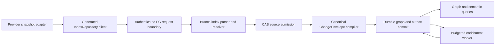

# EG-REPO-INGEST implementation plan

Governing outcome: [spec.md](spec.md). Normative data and failure contract: [architecture.md](plan.md).

## Existing implementation to extend

The generated/public shapes are `crates/eg-types/src/ingestion_wire.rs` and `epistemic_graph/generated/index_repository.py`. The native parser and branch projection live in `crates/eg-compute/src/parser/branch_index.rs`. `src/server/dispatch/graph_pipeline/repository_index.rs` applies graph scope and ACL, parses off the reactor, admits source bytes and calls `src/server/handlers/repository_index.rs`. That handler lowers to a canonical write set and one `ChangeEnvelope`, with current `REPOSITORY_BATCH_TOO_LARGE` budgeting. `src/server/repository_enrichment_worker.rs` and its dispatch consumer are the existing durable work path. `src/server/handlers/source_ingestion.rs`, `crates/eg-types/src/source_ingestion.rs` and `docs/architecture/source_ingestion.md` implement the general source contract. These are the owners to reuse, not templates for a second service.

Current evidence includes branch-aware durable tests in `tests/repository_index_durable.rs`, parser tests in `crates/eg-compute/src/parser/branch_index_tests.rs`, generated result contract tests, and source-ingest tests. They establish parts of RI-01–RI-06 and RI-11. They do not prove full semantic bridge coverage, all failure reparse behavior, production throughput, or an accepted release. The implementation must inspect the exact current revision before claiming a gap is still present.

## Sequenced changes

1. **Freeze the contract.** Confirm generated `IndexRepository` and `SourceIngest` schemas, stable parse-disposition and refusal codes, bounds and feature-gating. Add contract fixtures for each error and parser outcome. Regenerate clients from authoritative schema; never hand-edit generated bindings.
2. **Complete identity and scope.** Canonicalize repository, revision, path, blob, file-version and per-occurrence symbol identities. Validate duplicate/conflicting membership and tombstones before CAS admission. Resolve the multiple-edge representation decision in [architecture.md](plan.md) with a regression.
3. **Complete parser and resolver.** Make per-file outcomes exact and repeatable. Preserve failed/unsupported blobs for capability-version reparse. Resolve cross-file calls/imports by scope and stable order; annotate unresolved cases; commit only admitted endpoints. Implement deterministic, versioned model-free similarity.
4. **Complete one-writer projection.** Extend `repository_index` lowering and `ChangeEnvelope` metadata with source/lineage and semantic-bridge relations. Keep CAS holder, graph projection, tombstone and outbox behavior atomic at the graph commit boundary. Retire any alternate graph mutation path after its callers use this path.
5. **Complete bounded enrichment.** Use the existing mutation outbox and worker; add admission and budget receipts, fenced retry/park and a bounded on-demand path. Native indexing must return without waiting for model work.
6. **Complete source-position consumers.** Extend approved `SourceIngest` mappings with idempotent graph/index/outbox projection and a Debezium-style envelope adapter. Preserve source position and explicit deletion. Implement bounded freshness wait and route evidence for accelerated reads.
7. **Prove integration and release.** Run the [test matrix](test-spec.md) on public fixtures, a fresh store and a restarted store. Publish exact commit, generated artifact digest, test command/result and benchmark environment in a local `evidence.md` when complete. Update this spec's delivery and acceptance independently.

## Interfaces and compatibility

Keep the existing `Method::IndexRepository { files_msgpack, scope }` entrypoint and typed `IndexResult`; add fields with explicit schema evolution and generated-client round trips. A caller can submit smaller batches on `REPOSITORY_BATCH_TOO_LARGE` without changing identity or replay semantics. Existing graph data may need a versioned re-index if symbol or file-version IDs change; never reinterpret persisted old IDs silently. New metadata must be optional or migrated with a tested one-time upgrade. Source-ingest checkpoint CAS is not relaxed for connector retries.

## Quality gates

Run focused parser, durable repository, source-ingest, generated-client and restart tests during development. Before landing code, use `pre-commit run --config .config/pre-commit.yaml --all-files` and `bash scripts/ci_parity.sh` where the environment supports the hosted matrix. Report any unrun service matrix separately. The repository's configured changed-code CCCC gate is `python3 scripts/check_complexity_staged.py` (no new cyclomatic over 10 or cognitive over 15). Dupehound is `python3 scripts/check_dupehound.py`. KISS is `bash scripts/check_kiss_staged.sh`. Jscpd differential is `python3 scripts/check_duplication.py enforce --base-ref <merge-base>` with the repository's scanner contract. The manual whole-tree CCCC census and jscpd census are defined in `.config/pre-commit.yaml`. Use those configured thresholds, not a fabricated score. Fix duplicate owner logic at the source. Do not suppress a legitimate finding or split a function solely to pacify a scanner.

The deterministic contract/unit tier must run from a clean checkout with local toolchain and temporary storage. Tests requiring a provider, model, cluster or credentials belong to an explicit opt-in served tier with a reproducible provision step. A missing live service cannot fail the offline contribution gate.

## Architecture

This document defines the engine-owned boundary and data model for [spec.md](spec.md).

### Authority and flow

The adapter is transport only. EG verifies graph write access before invoking parser work. The request boundary validates a portable repository-relative path, digest spelling, bounded scope, and feature availability. Parse and projection run off the network reactor. CAS admission can precede the graph transaction; a CAS holder has no graph visibility until the one envelope commits. The envelope is the sole graph writer for this path. The response is emitted after the commit, or on exact digest replay after reading its durable receipt.

`SourceIngest` is the parallel entrypoint for governed connector observations. It uses approved manifest mapping references, EG-computed live-set differences and the same `ChangeEnvelope` commit authority. A source-position bridge or index update is a consumer of that committed envelope, keyed by tenant, source ID, partition and position; it cannot reimplement graph mutation outside the envelope path.

### Entity and identity model

| Entity | Identity | Required durable fields |
|---|---|---|
| Repository | verified tenant + canonical repository ID | source kind, schema version, access class |
| Ref | repository + ref name | status and immutable current revision ID |
| Revision | repository + canonical immutable commit ID | parent IDs if supplied, observed time, evidence digest |
| Blob | content SHA-256 (stored under tenant/repository holder) | content reference, length, parser capability digest, parse disposition |
| FileVersion | repository + revision + normalized relative path + blob digest | path, blob link, validity and provenance |
| SymbolOccurrence | FileVersion + byte start/end + symbol kind + disambiguator | declaration name, language, span, parse evidence |
| Resolved edge | relation + source occurrence + target occurrence + algorithm/schema version | provenance, confidence when statistical |
| Work item | snapshot digest + enrichment kind + policy/admission version | budget, attempt, lease, state, output receipt |

Never key an occurrence solely by source text or blob digest: one blob can be mounted at different paths and refs, and identical declarations can appear twice. Branch membership is a relation to an immutable `FileVersion`; removing membership does not delete another ref's graph. Ref names can move, commit IDs cannot. Exact path normalization rejects absolute paths, traversal and URI-like host paths. Hash digests use lowercase `sha256:<64 hex>`.

The parser outcome is one `IndexFileOutcome` per submitted unique blob, preserving order. `success`, `unsupported` and `error` are distinct. A parse capability digest identifies the parser grammar/configuration so a later capability revision can retry failed/unsupported material without changing the immutable source digest. Diagnostics are bounded and machine readable. Rung evidence is derived inside EG and is not trusted from the request.

### Symbol resolution and semantic bridge

Parsing first produces file-local declarations and unresolved references. A deterministic second pass builds lookup indexes by language, module path, scope, exported name and arity. It resolves within the admitted snapshot, prioritizes exact receiver/import scope, and records ambiguity or external-package references as unresolved counts. Candidate ordering is canonical; neither filesystem enumeration nor hash-map order changes the result. Statistical `similar_to` edges require a versioned algorithm, score threshold, deterministic tie-break and provenance. An inferred target must already be an admitted node. `depends_on` connects actual source file versions, never raw import strings.

The semantic bridge projects typed relations for `declares`, `calls`, `inherits`, `realizes`, `depends_on`, `definedBy`, `testedBy`, `specifiedBy` and `releasedIn`. All relations point to stable graph IDs and carry the source evidence digest plus projection schema version. A spec, test or release artifact can enter only through authenticated source indexing or another approved ingestion contract. A missing target is recorded as unresolved rather than fabricated. Query permissions are evaluated before returning content or provenance. Bridge projection shares the envelope writer and tombstone rules.

### Atomicity, replay and recovery

Lowering canonicalizes properties and graph methods, validates the complete operation and MessagePack item/byte budget, and hashes the lowered write set. The envelope includes policy and privacy attestation, source references, provenance, tombstones and optional outbox intent. The graph version, projection, cursor/marker and receipt commit together. Identical request digests replay; same external id with different content is a conflict. Over-limit requests return `REPOSITORY_BATCH_TOO_LARGE` before graph commit. A client may split the batch; each split remains independently atomic and converges to the same final graph.

A restart reads the committed envelope and source marker from durable storage. Incomplete CAS admission is recoverable or garbage-collectable by holder policy but never advertised as indexed. Outbox leases are durable and fenced; a worker may reattempt after crash without duplicating a completed result. With replication enabled, write and worker submission require current placement/leader authority. An unsupported feature build returns a stable feature refusal; it cannot return a success shaped like an empty index.

### Security and operational decisions

- The verified request identity sets tenant and graph. A repository ID in payload is an identifier inside that authority, not an authorization credential.
- Preserve useful code text while replacing host identity in materialized properties. Raw bytes are tenant-scoped in CAS and subject to the graph's read policy.
- No live provider, credential, local inventory or model endpoint is needed for unit/contract tests. Provider adapters must supply their own reproducible fixtures.
- The native commit path is independent of enrichment. The worker uses engine-controlled admission, budget, grant and retry policy; model failure cannot roll back an already accepted native snapshot.
- Reuse the existing graph ACL, CAS, `ChangeEnvelope`, mutation outbox and generated contract mechanisms. New parser or projection abstractions need a demonstrated gap and a caller through the real service route.

### Recorded design decision: edge identity is the `(source, target, relation_type)` triple

The graph previously keyed some edges by endpoint pair alone, so multiple relation types between the same two endpoints had no canonical representation. Decided (operator-approved, EG-REPO-INGEST-R009.1/R009.2): an edge's identity is the triple `(source_id, target_id, relation_type)`, not the bare `(source_id, target_id)` pair. An untyped legacy edge migrates deterministically by reading its stored blob's `type`/`label` field as `relation_type`, falling back to `related_to` when neither is present; a migration collision (two untyped edges landing on the same triple) is resolved by a deterministic collapse rule and recorded in a collision receipt rather than silently dropped. The semantic bridge's nine relations (`declares`, `calls`, `inherits`, `realizes`, `depends_on`, `definedBy`, `testedBy`, `specifiedBy`, `releasedIn`) each project onto their own typed triple between the same two endpoints, so they never collide with each other or with an untyped edge.

Rejected alternatives:

- **Priority rule.** Pick one relation type to "win" per endpoint pair by a fixed precedence order. Rejected: it is not a representation at all — every lower-priority relation between the same two endpoints is unrepresentable the moment a higher-priority one exists, which is exactly the silent-drop failure mode this decision exists to close.
- **Set-of-types on one edge.** Keep one edge per endpoint pair and widen its `relation_type` field to a set. Rejected: it collapses distinct relations' independent properties, provenance and lifecycle (add/remove/invalidate timing) onto one shared record, and a removal of one type cannot be expressed without either deleting the whole edge or mutating the set in place with no edge-level audit trail.
- **Reified relation nodes.** Model each relation as its own graph node with edges to its source and target. Rejected: it multiplies node count by the relation volume, forces every relation-aware query through an extra hop, and provides no benefit over a typed edge for a binary relation that carries no further relations of its own.

## Amendments

### 2026-10-11: correct acceptance-evidence scope

Audit of revision `660ae016` found that the bindings for
`EG-REPO-INGEST-R003.1`–`EG-REPO-INGEST-R003.11` identified typed enum
serialization and local claim-list checks in
`crates/eg-types/src/source_ingestion/tests.rs`. These remain useful
supplementary unit evidence, but do not execute the migrated capabilities or
prove that their legacy modules no longer perform the same computation.
The child acceptance and therefore the R003 rollup remain unverified by this
evidence. Reopening T1 and T1a–T1k records that proof gap, not a conclusion that
all implementation is absent.

The R008-bound test in `src/server/handlers/repository_index_tests.rs` constructs
roughly 60 MB of payload, exceeds the 48 MiB write-set ceiling, and invokes
`lower()` on the full and halved fixtures. It proves the stable refusal prefix
and successful lowering of the smaller fixture. It does not exercise a batch
above 64 MiB through a served request, graph commit, or SDK halve-and-resend
retry. T2 remains open for that integration proof; its already established
contract and lowering checks remain supplementary evidence.

Remove full-acceptance bindings from these unchanged test bodies and regenerate
status with the official spec hooks. Preserve every normative requirement and
all existing implementation. Historical landing trailers remain historical
implementation evidence; a generated LANDED state without `verified_by` does
not establish acceptance. Full acceptance still requires the consumer/retirement
and served boundary evidence specified in requirements.md and test-spec.md.

<!-- spec-definition-patch:owner-batch-20261012-repository-index-and-ingestion -->
## Reviewed residual closure plan — owner batch 2026-10-12

### `EG-REPO-INGEST-R002.1` — AU:23

- Existing EG parent/rollup: `EG-REPO-INGEST-R002`; preserve its existing obligations.
- Original objective: A skill document's procedural steps compile into an executable plan with no separate workflow file, and the graph references the skill directory instead of copying it.
- Original intake fields (exact source record array): ["AU-CONTROL","A skill document's procedural steps compile into an executable plan with no separate workflow file, and the graph references the skill directory instead of copying it.","mechanism","","prompts/plans/brain_plan_329dec44...v1_20260525_002700.md","MEDIUM","WRITE"]
- Contract definition: SourceIngest skill_workflow_ingest SHALL compile the procedural steps in a pinned SKILL.md into a typed TaskPlan without requiring a separate workflow file. Each admitted step SHALL have a unique step_id, source span, instruction digest, capability identifier, typed inputs and outputs, and dependency identifiers. The compiler SHALL resolve capabilities and input/output bindings before producing a plan, order independent steps by their source order, and refuse missing or duplicate identifiers, unresolved dependencies or capabilities, cycles, unsupported types, or absent source spans. The compilation receipt SHALL bind the skill-directory reference, document revision/digest, grammar revision, plan revision/digest, and tool/type digests. The graph SHALL store the directory reference and compilation provenance rather than a copy of the skill document. A changed document or capability/type digest SHALL invalidate the old binding before execution; unstructured prose SHALL NOT silently become an executable operation.
- Production wiring and owner boundary: Attach compilation to the existing SourceIngest skill_workflow_ingest capability. The proposed AU-CONTROL-R037.30 binding enters the existing graph_orchestrate → gap/plan selection → execute_workflow path; do not add a parallel document executor.
- Planned acceptance: Proposed integration case skill_document_alone_compiles_and_executes: provide a skill directory containing SKILL.md and its permitted assets, with no workflow file. Invoke real SourceIngest, fetch the resulting plan through AU graph_orchestrate, then run execute_workflow and verify independently observed step effects and preserved data bindings. Mutate the document between compile and run and require refusal before the affected step. Exercise duplicate step IDs, a cycle, unknown capability, wrong binding type, and a missing span. Verify the graph contains the directory reference and receipt, not copied document text.
- Preserve existing coverage: `AU-HARNESS-R022.2`, `AU-CONTROL-R037.3`, `AU-CONTROL-R037.5`, `EG-REPO-INGEST-R002`.
- Source record: `AU:23` SHA-256 `3f7e133169a76ce2680ec667c28ea2c5543354ed8874d258c432e65346f2e529`. Owner references: epistemic-graph@e1db3f4359e659dc07fb0e0ba5e021bed40c9f26:specs/repository-index-and-ingestion/requirements.md:6 (EG-REPO-INGEST-R002); agent-utilities@50c313ab01871ff7e10aee2a9d0254fa55d71f07:specs/harness-evolution/requirements.md:111 (AU-HARNESS-R022.2); agent-utilities@50c313ab01871ff7e10aee2a9d0254fa55d71f07:specs/agent-control-plane/requirements.md:59 (AU-CONTROL-R037.3); agent-utilities@50c313ab01871ff7e10aee2a9d0254fa55d71f07:specs/agent-control-plane/requirements.md:61 (AU-CONTROL-R037.5).
- Explicit owner holds: The versioned SKILL.md procedural grammar and authoritative capability/type lookup must be published by their owners before implementation can satisfy this clause. AU-CONTROL-R037.30 is unmerged; document compilation is not proven by the SourceIngest capability name.
- Unmerged consumer dependencies: AU-CONTROL-R037.30 (draft/unmerged).
- Proposed owner-review choices, not source-established facts: Step fields, deterministic source-order tie breaking, and compilation receipt are proposed contract details. No particular Markdown grammar is claimed already chosen..
- Keep status SPECIFIED with empty landed_in/verified_by until separately reviewed implementation and served evidence exist; no receipt is inferred.

### `EG-REPO-INGEST-R006.1` — AU:70

- Existing EG parent/rollup: `EG-REPO-INGEST-R006`; preserve its existing obligations.
- Original objective: Ingestion throughput is profiled per stage against a target of 2000 papers per day; maintenance backlog purge and per-goal budget allocation are prioritized when throughput falls below target.
- Contract definition: EG SHALL measure distinct canonical paper IDs that completed every required ingestion stage in the half-open rolling UTC window [window_end minus 86400 seconds, window_end). The target SHALL be 2000 completed papers per such window. Stage receipts SHALL record stage/revision, attempted and distinct completed IDs, duplicate count, elapsed time, and source/commit evidence. Retries SHALL NOT increase the completed-paper count. A partial or stale window SHALL be reported as unknown and SHALL NOT be compared as a full day. Below target, the committed decision SHALL name the count, shortfall, stage bottleneck evidence, and ordered actions: first assess safe maintenance candidates, then allocate the remaining declared budget across identified goals. A purge candidate SHALL be terminal, unleased, and non-authoritative, with retained durable source/decision receipts. Active work, authoritative records, and the last source copy SHALL be ineligible. Each action SHALL carry owner authorization, expected revision, cost ceiling, and admission verdict; missing authority or policy inputs SHALL refuse it before effects.
- Production wiring and owner boundary: Read stage and work-item receipts from the native SourceIngest/deferred-work path under R006. EG owns the shortfall decision and per-goal allocation; AU observes the result; GraphOS executes admitted maintenance. Keep its concrete operation ID and producer/export binding as a dependency until that owner publishes them.
- Planned acceptance: Proposed integration case paper_shortfall_drives_admitted_maintenance: ingest a known 24-hour stream through real stage completion and durable work queues with duplicate attempts, failures, and boundary timestamps. Independently count 1999 then 2000 unique completed papers and verify trigger/no-trigger decisions. Inspect goal allocations and their aggregate budget bound. Send admitted maintenance through the actual GraphOS owner route and read its result receipt. Active leases, changed revisions, the last source copy, missing authorization, and stale telemetry must cause no purge. An incomplete window must be unknown. Queue-only or planner-only fixtures do not establish completion.
- Preserve existing coverage: `AU-RETIRE-R005`, `EG-REPO-INGEST-R006`.
- Source record: `AU:70` SHA-256 `902f964dd909186f3a31d1f8a84d146b715446e64dfeec62480c8151baa06996`. Owner references: epistemic-graph@e1db3f4359e659dc07fb0e0ba5e021bed40c9f26:specs/repository-index-and-ingestion/requirements.md:21 (EG-REPO-INGEST-R006); agent-utilities@50c313ab01871ff7e10aee2a9d0254fa55d71f07:specs/au-engine-duplicate-retirement/requirements.md:14 (AU-RETIRE-R005).
- Explicit owner holds: The owner-selected stage set, window-freshness policy, per-goal allocation objective/tie-break policy, and GraphOS maintenance operation/authorization contract are not established in the reviewed source. Do not invent IDs, budget defaults, or a purge executor; publish these as explicit prerequisites.
- Unmerged consumer dependencies: none.
- Proposed owner-review choices, not source-established facts: Distinct end-to-end completions and the exact window define the proposed throughput oracle. Stage telemetry remains separate from the end-to-end numerator..
- Keep status SPECIFIED with empty landed_in/verified_by until separately reviewed implementation and served evidence exist; no receipt is inferred.

### `EG-REPO-INGEST-R006.2` — AU:92

- Existing EG parent/rollup: `EG-REPO-INGEST-R006`; preserve its existing obligations.
- Original objective: After a sync, embeddings are updated asynchronously with an importance penalty so high-importance features resist change; consolidation never runs in the routing loop.
- Contract definition: After a successful sync commit, EG SHALL queue a durable re-embed job bound to the committed source revision, embedding space/model revision, old vector digest, and importance-policy revision. The worker SHALL form an importance-regularized candidate outside the routing loop. Proposed squared_l2_anchor_v1 uses L(z)=sum((z_i-p_i)^2)+lambda*sum(w_i*(z_i-o_i)^2), where p is the proposed vector, o is the old vector, finite w_i are nonnegative, and finite lambda is strictly positive; its coordinate result is (p_i+lambda*w_i*o_i)/(1+lambda*w_i). All vectors and weights SHALL have the same declared dimension and coordinate system. No silent rescaling or normalization SHALL follow this calculation. Missing/stale importance evidence, incompatible spaces, nonfinite values, or a superseded source/old-vector revision SHALL refuse before promotion. The candidate SHALL remain shadow data until the existing recall gate passes; failure SHALL retain the prior active version. Query routing SHALL perform neither this consolidation nor its embedding/model calls.
- Production wiring and owner boundary: Queue through EG-FEDERATED-QUERY-R077.3. Gate promotion through EG-UNIFIED-DATA-PLANE-R040.2/.3 before EmbeddingVersionStore::tag_batch; read the embedding binding in the existing worker path. R040.3 expressly records that the production tag caller must be created. EG-FEDERATED-QUERY-R040.3 is not this gate.
- Planned acceptance: Proposed integration case sync_importance_penalty_is_async_and_gate_bound: commit through the real sync path, drain its durable re-embed worker, and compare equal proposed coordinate displacements under low and high importance; higher importance must produce less displacement. Check exact candidate math, provenance, idempotent job handling, and the existing promotion gate before tag_batch. Stale jobs, absent importance evidence, and failed recall probes must leave the active binding unchanged. Instrument the served routing path and prove zero consolidation/embedding calls while the deferred job is pending and after completion.
- Preserve existing coverage: `EG-REPO-INGEST-R006`, `EG-UNIFIED-DATA-PLANE-R040.2`, `AU-CONTEXT-R002`.
- Source record: `AU:92` SHA-256 `771acc731a6e25746641adf30cde9ec91f4eb56edd6597f2d308a42947a3abb3`. Owner references: epistemic-graph@e1db3f4359e659dc07fb0e0ba5e021bed40c9f26:specs/repository-index-and-ingestion/requirements.md:21 (EG-REPO-INGEST-R006); agent-utilities@50c313ab01871ff7e10aee2a9d0254fa55d71f07:specs/agent-context-and-finance/requirements.md:6 (AU-CONTEXT-R002); epistemic-graph@e1db3f4359e659dc07fb0e0ba5e021bed40c9f26:specs/federated-query-and-reasoning/requirements.md:95 (EG-FEDERATED-QUERY-R077.3); epistemic-graph@e1db3f4359e659dc07fb0e0ba5e021bed40c9f26:specs/unified-data-plane/requirements.md:153 (EG-UNIFIED-DATA-PLANE-R040.2); epistemic-graph@e1db3f4359e659dc07fb0e0ba5e021bed40c9f26:specs/unified-data-plane/requirements.md:154 (EG-UNIFIED-DATA-PLANE-R040.3).
- Explicit owner holds: The authoritative per-coordinate importance producer, revisioned export, and compatible embedding-space policy are not identified by the source. This is an explicit producer hold. The mathematical profile is proposed for owner acceptance; do not claim it was specified by the original source or already implemented.
- Unmerged consumer dependencies: none.
- Proposed owner-review choices, not source-established facts: squared_l2_anchor_v1 is a precise proposed penalty, not a paper-derived claim. If the owner chooses a different profile, it must publish an equally exact objective and monotonic resistance oracle; generic importance weighting is insufficient..
- Keep status SPECIFIED with empty landed_in/verified_by until separately reviewed implementation and served evidence exist; no receipt is inferred.

### `EG-REPO-INGEST-R006.3` — EG:54

- Existing EG parent/rollup: `EG-REPO-INGEST-R006`; preserve its existing obligations.
- Original objective: The graph exposes structured code maps (modules, symbols, call and dependency relations) so an agent can ask where a behavior lives; stale maps are refused after source change.
- Contract definition: The existing unified query surface SHALL accept a typed code-map query containing tenant, repository identity, current source revision, behavior text or symbol selector, requested relation kinds, and bounded page limits. Its result SHALL bind the map generation, source-inventory revision/digest, query digest, and authorization scope, and contain module/symbol entity IDs with language, path, source span, and source revision plus typed contains, calls, and depends_on edges. Behavior matches SHALL resolve to indexed source entities and cited spans; unsupported or unresolved relations SHALL be marked incomplete rather than invented. Authorization SHALL precede results, counts, and cursors. Every page SHALL compare the map binding with the authoritative current repository source revision; a changed or unknown revision SHALL refuse as stale before serving map data, including an unchanged symbol from the older generation. A cursor SHALL bind the same map, query, and authorization revisions.
- Production wiring and owner boundary: Produce maps in the native IndexRepository/SourceIngest path and consume them through Method::UnifiedQuery and its existing unified execution path. Add a typed code-map query/result mode there; do not add a separate search service or use an LLM answer as authoritative code-map evidence.
- Planned acceptance: Proposed integration case current_code_map_locates_behavior_and_refuses_old_generation: index a repository through the served route, query behavior and a symbol through the generated unified client, and independently check modules, symbols, call/dependency edges, and source spans. Modify one source file; both changed-symbol and unchanged-symbol queries plus the old cursor must refuse until a complete new map is published. Reindex and verify changed/deleted/renamed entities and unchanged logical entity identities against current files. Exercise unauthorized tenants, changed authorization, bounded pagination, and an unresolved relation without fabricated certainty.
- Preserve existing coverage: `EG-FEDERATED-QUERY-R017`, `EG-REPO-INGEST-R006`, `EG-REPO-INGEST-R009`.
- Source record: `EG:54` SHA-256 `e69e6fa3a5c26ae763809d600cb7d264d028b9ce0d80f8ca6141e1a40cf0638e`. Owner references: epistemic-graph@e1db3f4359e659dc07fb0e0ba5e021bed40c9f26:specs/repository-index-and-ingestion/requirements.md:21 (EG-REPO-INGEST-R006); epistemic-graph@e1db3f4359e659dc07fb0e0ba5e021bed40c9f26:specs/repository-index-and-ingestion/requirements.md:24 (EG-REPO-INGEST-R009); epistemic-graph@e1db3f4359e659dc07fb0e0ba5e021bed40c9f26:specs/federated-query-and-reasoning/requirements.md:21 (EG-FEDERATED-QUERY-R017).
- Explicit owner holds: Bind the authoritative current source-inventory producer and existing code-entity ID scheme before implementation. An optional historical query must be separately explicit; it cannot satisfy the current-map guarantee.
- Unmerged consumer dependencies: none.
- Proposed owner-review choices, not source-established facts: The request/result carrier and cursor bindings are proposed additions to the existing query surface, not current implemented API claims..
- Keep status SPECIFIED with empty landed_in/verified_by until separately reviewed implementation and served evidence exist; no receipt is inferred.

### `EG-REPO-INGEST-R006.4` — EG:55

- Existing EG parent/rollup: `EG-REPO-INGEST-R006`; preserve its existing obligations.
- Original objective: Repository indexing is incremental, bounded in memory and releases resources on completion; it optionally resolves semantic types for the most common languages beyond syntax.
- Contract definition: IndexRepository SHALL apply an authorized added/modified/deleted/renamed file delta against an exact base and target source revision. A mismatched base SHALL refuse before index mutation. Unchanged files SHALL reuse their parse/index artifacts; deleted and renamed entities/edges SHALL be removed or rebound by the completed target generation. The job SHALL receive a positive max_working_bytes within its host grant, account all job-owned parser/index buffers and worker allocations, and reserve each allocation before use. It SHALL backpressure or refuse before exceeding that bound, not merely report excess afterward. Existing per-batch atomic refusal remains required; only a complete target generation may become the current code map. Completion, cancellation, and failure SHALL release job buffers, handles, and workers while keeping the shared engine usable. Optional semantic typing SHALL use a versioned language/parser/resolver support table. Unsupported semantic mode SHALL explicitly refuse or return an explicitly requested syntax-only result; grammar availability SHALL NOT imply semantic-type support.
- Production wiring and owner boundary: Attach delta handling to existing SourceIngest/IndexRepository and SDK-SOURCE-INGEST-R004; retain R007 batch admission and native/deferred separation under R006. Extend the existing parser/index workers and owner resource accounting. Research context: Martin Vogel et al., Codebase-Memory (2026), https://arxiv.org/abs/2603.27277. That paper motivates the approach but does not define this product contract or its supported language matrix.
- Planned acceptance: Proposed integration case incremental_index_respects_memory_and_releases_resources: run the actual repository index route with an add/modify/delete/rename delta, count parser calls to prove unchanged files are not reparsed, and independently inspect the complete target map. Use an instrumented allocator and worker accounting to show peak job-owned bytes never exceed the grant; reject an over-limit reservation before allocation. Verify no partial target map becomes current and the previous map remains usable after failure. On success, cancellation, and injected parser failure, verify all job allocations/handles return to the declared baseline and a subsequent job succeeds. Run cross-file semantic-type fixtures for every advertised supported table row and reject unsupported modes.
- Preserve existing coverage: `EG-REPO-INGEST-R006`, `EG-REPO-INGEST-R007`, `EG-REPO-INGEST-R010`, `SDK-SOURCE-INGEST-R004`.
- Source record: `EG:55` SHA-256 `340c1817f2a52dc6da4c9c13d93d215debbeb9fefd8b84b8d2400b86541d4d81`. Owner references: epistemic-graph@e1db3f4359e659dc07fb0e0ba5e021bed40c9f26:specs/repository-index-and-ingestion/requirements.md:21 (EG-REPO-INGEST-R006); epistemic-graph@e1db3f4359e659dc07fb0e0ba5e021bed40c9f26:specs/repository-index-and-ingestion/requirements.md:22 (EG-REPO-INGEST-R007); epistemic-graph@e1db3f4359e659dc07fb0e0ba5e021bed40c9f26:specs/repository-index-and-ingestion/requirements.md:27 (EG-REPO-INGEST-R010); agent-connector-sdk@5babc4cc48ad73928468b243842f219f51e2cca1:specs/SDK-SOURCE-INGEST/requirements.md:8 (SDK-SOURCE-INGEST-R004).
- Explicit owner holds: The owner must choose and publish the initial semantic-language/resolver matrix and exact host resource-grant binding. Do not substitute grammar counts, the paper's language count, or an arbitrary common-language list. Resource evidence must include native parser/worker allocations, not only language-runtime heap counters.
- Unmerged consumer dependencies: none.
- Proposed owner-review choices, not source-established facts: The bound is explicitly job-owned working memory, with shared engine memory separately accounted by the host; do not describe it as a whole-process RSS limit. The initial semantic-language roster remains a source decision hold..
- Keep status SPECIFIED with empty landed_in/verified_by until separately reviewed implementation and served evidence exist; no receipt is inferred.

<!-- /spec-definition-patch -->

<!-- spec-definition-patch:reviewed-mapped-subsets-20261012 -->
## Mapped definition implementation plan — 2026-10-12

### `EG-REPO-INGEST-R002.100` / AU:118

- Extend existing parent `R002` without removing its existing behavior.
- Specify: Extend the existing SourceIngest/result persistence contract with a write receipt binding run id, tenant, query digest, ordered result ids/content digests, graph revision and source provenance. The consumer performs a separately authorized read-only query after the write, binds its principal/grant revision and selector to that receipt, and compares every expected result id/digest/revision. A run may report success only after a matching readback receipt; missing, partial, stale, denied or mismatched readback is a typed non-success. Do not introduce a second graph writer.
- Producer/consumer boundary: EG owns durable graph write/read; AU owns execution success reporting. Reuse SourceIngest and existing query authorization, with explicit cross-owner consumer link.
- Owner prerequisite: no exact reviewed AU companion requirement ID currently binds its execution-success transition to this EG readback receipt. Keep the AU consumer ID unassigned and treat this consumer evidence as missing; do not infer an ID.
- Source record SHA-256: `e8ad0c2417b7fa6ce53c46899f1adf8e925977becd0bd1813db6b62d3786af11`.
- Keep status SPECIFIED until the EG served producer and each separately owned consumer are implemented, served-tested and independently read back.
<!-- /spec-definition-patch -->

<!-- spec-definition-patch:final-mappings-20261012 -->
## Final mapping implementation plan — 2026-10-12

### `EG-REPO-INGEST-R002.101` / PIPE:10

- Preserve parent `EG-REPO-INGEST-R002` and its existing clauses.
- Define: Bind the workflow id/revision loaded from the graph, EG committed plan/decision digest, AU execution run and output digests, SourceIngest write receipt, resulting graph revision and separately authorized readback receipt. The acceptance path uses the real graph_orchestrate -> find_workflow_gaps/fill_workflow_gaps -> execute_workflow consumer and EG graph load/decision plus SourceIngest; a separate authorized graph query must read back the hydrated content and match its digest before the gate reports success. Fake engines/catalogs and generic handoff receipts do not satisfy this contract. Missing/stale workflow, execution mismatch, write failure or denied/partial readback is non-success.
- Producer/consumer: EG owns workflow graph load/decision and durable SourceIngest; AU owns graph_orchestrate/execution; SDK supplies source-effect runner. Pipelines owns the gate only and does not add a runtime orchestrator.
- Owner prerequisite: no exact reviewed AU companion requirement ID is identified for graph_orchestrate/execute_workflow to gate success on this EG hydration readback. Keep the AU consumer ID unassigned and treat execution-success evidence as missing; Pipelines gate coverage does not establish the AU consumer.
- Source record SHA-256: `e0c431512565acb1a8ae00e09b63ec6fb7c8f9e81ef9c786a0fd7b26b2239455`.
- Keep status SPECIFIED until each named producer and consumer is separately implemented, served-tested and independently read back.
<!-- /spec-definition-patch -->
