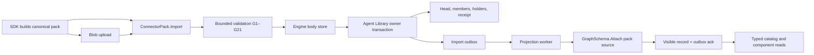

# Delivery and integration plan

## Design decisions

The implementation extends EG's current typed pack, component, schema, outbox and capability registry. It adds no separate pack database or dynamic response envelope. It adds no second contract generator or graph projection side channel. The public wire is generated from `eg-capabilities`; canonical receipt content must be compared byte for byte. Changes to a shared wire shape land as one coordinated revision across Rust, generated Python/Go/JS and the SDK TCK.

The order below minimizes incompatible intermediate states. A step may be a verification or repair of existing code. The existence of a module is not proof that the step is accepted. Each step maps to `tasks.md` and `test-spec.md`.

1. **Freeze contract and baseline.** Record the exact default-branch revision, current pack schema version and generated receipt. Run contract generation in check mode, full test inventory, CCCC, jscpd, Dupehound and KISS scans. Compare committed artifact *content* across all output directories. Classify findings as fixed, open or unrelated with exact evidence.
2. **Type and encoding proof.** Audit `eg-types` bounds, kinds, digest framing, sorted lists, optionals and canonical fixture vectors. Make the SDK's JSON serialization and deterministic idempotency key a shared TCK contract. Extend generated method/result descriptors rather than hand-writing client DTO copies.
3. **Admission and atomicity proof.** Audit G1–G21, tenant/importer checks, reserved IDs, preflight size checks and stable codes. Ensure the import planner resolves staged pins, stages engine bodies with holder/refcount invariants, and commits all owner rows plus N outbox intents atomically. Test all crash windows and replay identities.
4. **Lifecycle and catalog proof.** Verify carry-forward, changed pin cascade, reversible withdrawal, permanent retirement, content reads, no-op import and mass-withdrawal override. Confirm typed ServerRegistry owns liveness and component/pack owner owns content; remove any shadow catalog after consumer migration.
5. **Schema and projection proof.** Reuse one G13–G16/K1–K7 validator for operator, pack and ingestion sources. Attach current pack schema in one graph commit. Mark visibility only after attach; use durable failure/retry and least-privilege row-scoped graph grant. Verify static `AttachPack` staleness and `GraphSchemaClasses` output. Preserve exact `IcvConfigure` behavior.
6. **Consumer and release proof.** Run an end-to-end connector fixture from SDK package creation through Import, projection, GraphOS typed read and an authorized body read. Run Go/JS/Python/Rust contract vectors and full integration suites on the exact commit. Include scanner and architecture gates, release workflow parity, and a crash/restart restore check. Publish exact evidence before setting a requirement to `ACCEPTED`.

## Interfaces and ownership

| Interface | EG owner | Caller/consumer contract |
|---|---|---|
| Pack wire and digest | `eg-types` connector-pack modules; generated fixtures | SDK creates index/archive and uses exact golden vectors. |
| Import and admin ops | `src/server/handlers/admin/connector_pack/` with typed method descriptor | SDK uses `Status` then deterministic Import; admin calls Bind/Unbind/Retire/Reproject. |
| Durable rows and body liveness | Agent Library owner tables plus `engine_bodies` | No client writes component rows or body holder state directly. |
| Projection and graph schema | Outbox worker; `GraphSchema` graph commit; visibility gate | Typed catalog, assembly and search consume only visible head state. |
| Fleet catalog | ServerRegistry liveness plus component content | GraphOS joins typed reads and may cache by version, without becoming content authority. |
| Contract receipt | `eg-capabilities` registry and `gen_contract` | Python/Go/JS senders and SDK verify method/result/signing vectors. |

## R016 digest v4: package version is provenance only

EG-TYPED-PACKS-R016 requires equal server pins across package releases with equal content. The v3 definition digest mixes `SourcePackage.package_version` into every server component digest. Two independent stores that import the same content under different releases therefore mint different server pins.

- **Versioned digest.** New writes mint digest v4 under domain `au-eg/agent-component-definition/v4`. v4 omits `package_version` from the provenance input. The entry still stores the package version as provenance text.
- **Read compatibility.** `AgentComponentEntry::validate` accepts a digest that matches v4 or v3. The v3 path keeps domain `au-eg/agent-component-definition/v3` and the old input set. No write mints v3.
- **No migration.** The record shape does not change, so `AGENT_COMPONENT_SCHEMA_VERSION` stays 3. Stored v3 rows validate in place. Retire keeps a row's recorded digest.
- **Domain separation.** Distinct domains stop a v4 digest from colliding with a v3 digest over different inputs.
- **One-time revision.** The first import after the upgrade recomputes the server pin under v4. A changed pin issues one ordinary revision for the server and its dependents. Later releases with equal content stay `Unchanged`.
- **Proof.** A unit test proves v4 equality across package versions and v3 read compatibility. The connector-pack test `package_versions_produce_equal_pins_in_independent_stores` returns.

## Migration and rollback

The current connector pack schema is version 2. Compatible additions keep existing method semantics and require regenerated artifacts. An incompatible version bump must refuse old payloads with a stable code and be coupled to client TCK changes. Agent Library layout changes use a registered layout lineage and named manifest refusal. No implicit destructive upgrade is allowed. Deployment rolls forward with dual-reader compatibility only if explicitly tested. Rollback to an older binary is rejected when its layout cannot read the new owner file. A projection failure leaves the committed pack invisible and re-drivable. ReconcileBodies reclaims only unheld bodies after the grace period. A static schema attachment on another graph remains at its recorded pack revision until an administrator reattaches it.

## Completion evidence

For each PACK requirement, attach a PR/merged commit link, contract receipt digest, focused test output, full release workflow run and, for runtime behavior, served fixture result. `evidence.md` can be added when a tested implementation is available; this proposed spec makes no passing claim. The acceptance matrix in `test-spec.md` is the authoritative proof list.

### Turtle parse identity repair

- EG-TYPED-PACKS-R093.1: Scope the public bounded/unbounded Turtle readers per invocation. Keep the existing label-preserving reader for catalogue composition, whose callers already apply document namespaces.
- EG-TYPED-PACKS-R093.2: Validate the served connector-pack reproject path with colliding member labels and repeatable composed digests before claiming the parent requirement complete.

## Architecture

### Existing path to extend

`crates/eg-types/src/connector_pack/{index,digest,annotations,ops,result,record}.rs` defines the wire values and bounds. `crates/eg-capabilities/src/domains/` owns method descriptors; `gen_contract` emits the public contract, receipt and clients. `src/server/handlers/admin/connector_pack/import/` validates and plans; `src/server/persistence/connector_pack/` owns the head, membership, receipt, bindings, visibility and outbox; `src/server/blob/engine_bodies.rs` owns bodies; `src/server/connector_pack_projection.rs` and `src/server/graph_schema/attach_pack.rs` provide projection and schema attachment. `src/server/handlers/admin/component_content.rs` serves bodies. New code must enter through these paths, not create a second registry or a detached adapter.

### Data flow and durable boundaries

The body store can commit before the Agent Library transaction. An orphan has no holder; reclamation follows the grace window. Agent Library rows and outbox intents commit together. Projection is intentionally asynchronous. `visible_record_id` is the read gate until the graph schema has committed. The projection worker reads the current head, not an obsolete event payload; its graph attach uses the pack record as a monotone source revision. The subsequent owner transaction marks visibility and acknowledges the event. If interrupted between commits, redelivery is idempotent.

### Pack encoding

Entries are a closed kind set: `mcp_server`, `tool`, `skill`, `prompt`, `ontology`, `shapes`, `model_profile`, `a2a_card`, `manifest`. Each entry has a URI, name, media type, raw-body section, optional input/output schema sections, typed annotations and bounded sibling references. Every section carries offset, length and SHA-256. Section ranges use checked arithmetic, cover the uncompressed archive once, and never overlap. Text is UTF-8 without BOM; JSON has no duplicate keys, NaN or infinity and is depth/node bounded. `$ref` remains data rather than a network fetch.

`Digest256::framed` hashes length-framed fields in domain-separated order. Nested digest values are 32 raw bytes. String lists are UTF-8 byte sorted and deduplicated. Integers are big-endian u64. Absent optionals encode an empty field. Tri-state booleans use `00` absent, `01` false, `02` true. `entry_digest` frames kind, URI, name, media type, body/schema digests, annotations digest and reference digest under `eg/connector-pack-entry/v1`. `pack_digest` frames connector, server-entry digest, count and URI-sorted entry digests under `eg/connector-pack/v1`. Archive offsets and package version are excluded. Tool input/output schema digests are computed by EG over the exact received bytes. The SDK must serialize MCP JSON objects deterministically before byte hashing and replay the shared vectors. The SDK's normalized contract pin is a claim, not an EG-verified digest.

### Identity, lifecycle and reads

The pack head is keyed by `(tenant, connector)` and includes binding revision, content digest, server pin, package provenance, record ID and projection state. Membership is keyed by pack URI and has a component ID, revision, content digest and lifecycle. Bodies are keyed by SHA-256 with holder rows to protect live content. A same-digest import produces no write. A changed entry or pinned server revision creates a new component revision; a removed entry is `Withdrawn`. Historical pinned records may resolve withdrawn revisions; new publication, search, assembly and candidate selection cannot. `Retired` is explicit and permanent, and a later return is refused. Pack-generated `mcp:` IDs cannot be directly published by the generic component method.

`Status` is a snapshot read and has no reap/write side effects. `Content` checks component-read authority and the exact revision and returns verified bytes. Bind/Unbind/Retire/Reproject and body reconciliation require admin rights. Import requires `agent:pack-control`, matching verified principal and tenant, an expected head, and a deterministic operation identity. A mass withdrawal (empty pack or over half of published members) requires an explicit override and admin capability.

### Validation table

| Rule | Required refusal or warning |
|---|---|
| G1 | Supported schema, valid connector/name, sorted unique URIs, closed kinds and URI schemes, exactly one server: `MALFORMED_INDEX` or `UNKNOWN_ENTRY_KIND`. |
| G2 | Index ≤1 MiB, entries ≤1024, references/list ≤64, archive ≤16 MiB, body ≤2 MiB, schema ≤1 MiB, record ≤4 MiB, batch within kernel budget: `PACK_TOO_LARGE`. |
| G3–G5 | Owner-scoped archive present, length/hash match, checked nonoverlapping full sections, all section/entry/pack digests recomputed: `ARCHIVE_MISSING`, `ARCHIVE_DIGEST_MISMATCH`, `MALFORMED_SECTIONS`, `PACK_DIGEST_MISMATCH`. |
| G6 | Unique derived IDs and no decision-owned kind: `DUPLICATE_COMPONENT_ID` or `FORBIDDEN_ENTRY_KIND`. |
| G7–G10 | UTF-8 without BOM. Bounded JSON with unique keys and object tool input schema. Restricted `SKILL.md` front matter with matching name and description. Tool input schema present: `MALFORMED_BODY` or `MISSING_TOOL_SCHEMA`. |
| G11 | Empty description is accepted with entry-name fallback and `EMPTY_DESCRIPTION` warning. |
| G12 | Native capability/modality IRIs have the correct root. Foreign absolute capability IRIs are recorded as claims with warning, not fabricated native facts. Malformed IRI, invalid cost/currency/latency/model bounds refuse as `UNKNOWN_CAPABILITY_IRI`, `INVALID_ANNOTATION` or `INVALID_FACTS`. |
| G13–G16 | Turtle ≤100000 triples, bounded IRI/literal, no `@base`/relative IRI/network import. EL+/RL ontology consistency within derivation budget. Per-file scoped shape blank nodes, no `sh:sparql SERVICE`. Bounded SHACL validation: `ONTOLOGY_INVALID`, `SHAPES_INVALID`, `ONTOLOGY_INCONSISTENT`, `VALIDATION_BUDGET_EXCEEDED` or `SHACL_VIOLATION`. |
| G17–G18 | References resolve to stated sibling kinds with no cycles; server-stamped drafts pass `AgentComponentDraft::validate`: `UNRESOLVED_REFERENCE`, `REFERENCE_CYCLE`, `INVALID_COMPONENT`. |
| G19–G20 | Bound importer matches; mass withdrawal requires explicit admin override: `IMPORTER_MISMATCH`, `PACK_MASS_WITHDRAWAL`. |
| G21 | Stop at 256 violations or exhausted step budget and indicate truncation: `VALIDATION_BUDGET_EXCEEDED`. |

### Schema source composition

One graph owns a bounded ordered map of `GraphSchemaSource { source_id, origin, revision, shapes, ontology }`. The composed digest derives from all source content and revisions; compiled policy and TBox are caches, never authority. Shapes from separate sources retain separate blank-node scopes; their union is conjunctive. Ontology composition adds source triples to the view's TBox. The shared bounded validator serves `IcvConfigure`, `GraphSchema.Attach` and pack G13–G16.

| Rule | Attach contract |
|---|---|
| K1 | One source owns each shape subject; another source cannot deactivate or change it (`SCHEMA_SOURCE_CONFLICT`). |
| K2–K3 | Shape and ontology documents are bounded, parseable, relative/base free. Imports resolve only within the same source and are never fetched. `SERVICE` constraints are refused. |
| K4 | EL+/RL classification is step bounded; new inconsistency or newly unsatisfiable named class is refused with an explanation. The exponential tableau is never invoked for admission. |
| K5 | Shared class/property IRIs are allowed; consistency, not duplicate naming, determines validity. |
| K6 | Pack/ingestion origin revision strictly increases or is an identical no-op; stale projection refuses `SCHEMA_SOURCE_REGRESSION`. |
| K7 | Source count, bytes and triples remain within configured bounds; overflow is `SCHEMA_SOURCES_TOO_LARGE`. |

`GraphSchema.AttachPack` reads visible engine-owned pack schema, never caller-supplied substitute bytes. `pack__<connector>` is reserved and only the authorized worker writes it. Other graph attachments are static snapshots with a visible record ID; automatic following needs a separately specified durable target list. `IcvConfigure` maps to the operator source, preserving its wire contract. Attach validates the staged schema and later writes; it does not retroactively scan all existing data. The `GraphSchemaClasses` read supplies canonical classes/properties and composition digest for consumers.

### Failure, security and compatibility decisions

The per-tenant lock serializes pack mutations but does not replace in-write head compare-and-swap. Cancellation is checked before expensive reasoning and before atomic commit; a cancelled request must release the lock. Outbox failure is a durable failed state, not a swallowed log; retry is bounded and does not collateral-dead-letter unrelated events. Projection's graph write uses a grant scoped to that outbox row. Clustered writes for this family are `LocalOnly`. Incompatible owner layout fails by named refusal at the manifest read; an offline upgrade path is rejected. The first schema corpus remains generated from typed Rust authority and preserves its public IRI vocabulary. New source and row types require the same generated contract/receipt update and compatibility tests.

## Amendments

### 2026-10-11: served admin regression fixtures

R002, R003 and R007 retain their runtime contracts. The import fixture must use
the deterministic connector/digest/expected-binding key before testing index
validation. Validation refusals, including `RETIRED_ENTRY_RETURNED`, are typed
`PackImportResult::Rejected` violations. Compare catalog state after retirement
with state after the refused reimport, so the retirement itself is not mistaken
for a rejected-import mutation. Reconciliation preserves every historical
revision holder. Revised and withdrawn bodies remain readable by pinned revision
(PACK-05). Only unheld bodies are orphans. The served regression
asserts historical and current body bytes after the sweep.
Catalog snapshot assertions share one helper.
This removes repeated setup without changing typed refusals or before/after equality checks.

### 2026-10-11: capability annotation acceptance

EG-TYPED-PACKS-R042.1 tests the production G12 validator and claim partition for both annotation fields. The parser now requires an ASCII letter at the start of an absolute IRI scheme. Foreign terms retain their exact text in the declared partition. EG-TYPED-PACKS-R042.2 keeps signed dispatch, persisted claims, and refusal atomicity open. Native tests alone do not close the parent requirement.

### 2026-10-11: modality annotation verification scope

EG-TYPED-PACKS-R043 previously named validation and digest replay without naming direct modality regressions.
The requirement stays unchanged. Both fields need native validation, typed bounds, and digest replay.
The tests below exercise existing production code. They do not replace PACK-09 served acceptance or release gates.
R043 remains open until TP-10, TP-11, and applicable quality gates pass on the merged head.

## Audit record

### 2026-10-11: R043 native and client evidence

Base: `ce34e41b7845fa220ec405508d392bc88a23b3f6`. No production behavior changed. R043 remains unverified.

- Rust 1.96 compiled current `crates/eg-types/src/lib.rs` with `feature="test-support"` against cached real dependencies.
- A native harness included current `src/server/handlers/admin/connector_pack/import/annotations.rs` by path. All 12 tests passed, exit 0.
- Both independent modality-direction guard deletions made `modalities_refuse_foreign_roots_typos_and_wrong_kinds` fail, exit 101. Original source was restored.
- `python -m pytest -q tests/test_connector_pack_client.py`: 9 passed, exit 0.
- `python -m ruff check tests/test_connector_pack_client.py`: passed. Rustfmt 1.96 formatted the new native tests.
- `pipelines-hook spec-decomposition --root .`: 20 specs passed. `pipelines-hook spec-standard --root .`: 19 specs passed.
- Fixture: `contract/fixtures/connector_pack_digest_vectors.json`, schema `eg-digest-vectors/v1`.
- Fixture SHA-256: `b2d1e0410853004a6cd3db63f660fbd99adfa87fd3d5839b008590dbc35fd8d6`.

The bounded Cargo attempt used `cargo test --offline -p epistemic-graph --lib --no-default-features --features server connector_pack::import::annotations --no-run`.
It exited 101 before compilation because the offline registry lacked `hex`.
Served import, persisted modality facts, refusal atomicity, TP-10, TP-11, and release gates remain unverified.
The native harness is evidence for the listed source tests only. It does not substitute for served acceptance.

### 2026-10-11 served regression slice

R042.2 adds signed G12 rejection cases with bounded owner-table, body-liveness,
and outbox snapshots plus persisted native/foreign claim and warning checks.
R093.2 extends forced Reproject with colliding member labels, durable schema
inspection, and fresh-key repeat identity checks.
The test markers bind these existing acceptance tests to their owning rows.
The generated lifecycle records test existence, independently of execution results;
the test specification links the native acceptance evidence.

## Measured model and task facts for harness configuration (R048, R066)

Data flow: evaluation run (agent-utilities) → pack import of a `model_profile` entry → `AgentComponentFacts::ModelProfile` (`crates/eg-types/src/agent_component/facts.rs:169`) → `AgentLibraryStore` → `Decide(harness_config)` handler (EG-DECISION-ENGINE-R128.8) → premises.

Types and fields:

- `contextWindowTokens` is the existing `context_window_tokens` field (`facts.rs:171`). It is a declared fact and needs no run reference.
- `shellProficiency` (`low`, `medium`, `high`) and `stoppingBehaviour` (`stops_early`, `balanced`, `over_verifies`) are new optional fields.
- Each wraps its value in `MeasuredFact<T>`, which holds an `evaluation_run_ref: ObservationRef`. `ObservationRef` is defined at `facts.rs:142` and already backs `latency_observed_ref`.
- `shellCentric` is a boolean on the task class `swarm:TaskShape` (`crates/eg-core/ontology/swarm_topology-v1.ttl:80`, the class that `swarm:DecomposableTask` extends).

Attach point: the digest function at `agent_component.rs:748` hashes the new fields only when present. An absent field must keep every existing digest vector.

Failure behaviour: a measured value without a run reference fails validation (R048.2, R066.1). An absent measured fact is valid. It makes the decision abstain for the part that needs it (EG-DECISION-ENGINE-R128.5 to R128.7).

Reused: `ModelProfile` and `ObservationRef`, the pack import path, `agent_ontology::broader_chain` for task-class inheritance. New: `MeasuredFact<T>`, two enums, `harness-v1.shapes.ttl`, `swarm:shellCentric`.

Decisions:

- Measured facts live on the model profile. Rejected alternative: a separate facts table. Facts then travel with the signed pack and its digest.
- An absent `shellCentric` stays absent. Rejected alternative: default `false`. A default `false` turns a missing fact into a `tool_set` answer without a typed abstention.
- The shapes file is new because `harness-v1.ttl` has no shapes sibling. The `swarm:shellCentric` shape extends `swarm_topology-v1.shapes.ttl` because that file validates task shapes.

Cross-repository rows: the `AU-HARNESS` row for the matched ablation runner writes `shellProficiency` and `stoppingBehaviour` with their run references. The `EG-DECISION-ENGINE` row R128 reads them.

## Tool-contract facts on pack annotations (R045)

Data flow: connector SDK pack (`SDK-CONNECTOR-CONTROL-R045.1` to `.11`) → `PackAnnotations` (`crates/eg-types/src/connector_pack/annotations.rs:46`) → `check_annotations` (`src/server/handlers/admin/connector_pack/import/annotations.rs:34`) → `tool_facts` (`src/server/handlers/admin/connector_pack/import/facts.rs:21`) → `AgentComponentFacts::Tool` (`crates/eg-types/src/agent_component/facts.rs:198`) → `request_body` (`src/server/handlers/decide/stat_tool_subset.rs:99`) → `smallest_covering_subset` (`crates/eg-types/src/decision/statistical/tool_subset.rs:58`) → `HarnessConfig` action space (`EG-DECISION-ENGINE-R128.9`).

Types and fields: `side_effects` (`none`, `workspace_write`, `external_write`, `network`), `declared_by` (`connector`, `mcp_hint`, `certified`) and `schema_tokens` (positive integer) are new optional fields beside `read_only_hint` (`annotations.rs:58`). Safe defaults when absent: `read_only` false, `side_effects` external_write, `declared_by` connector, `schema_tokens` absent.

Attach points: the digest at `digest.rs:135` hashes the new fields only when present, so old vectors hold. The facts copy at `facts.rs:41` adds the three fields. The cost read at `stat_tool_subset.rs:91` switches from "0 when undeclared" to "no value", and the candidate loop abstains on it.

Failure behaviour: admission refuses an unknown value or a zero size with a typed refusal naming the field. A tool without a size makes the `tool_subset` part abstain. An `mcp_hint` read-only claim is stored unproven and maps to a write effect, so no premise treats it as certified.

Reused: `PackAnnotations`, `tool_facts`, `ToolCoverageCandidate.token_cost` (`tool_subset.rs:20`), `smallest_covering_subset`, `gen_contract --check`. New: three fields, one default method, one admission check, one abstention path.

Decisions:

- The size is `schema_tokens` on the annotation. Rejected alternative: estimate from the schema digest in the engine. The engine then guesses a size that the connector can state.
- A missing size abstains. Rejected alternative: default 0, as `token_cost` does today. A free tool always wins the greedy density order and silently overruns the budget.
- A `read_only` claim from `mcp_hint` stays unproven. Rejected alternative: trust all hints. An MCP hint is a server claim, so parallel execution of such a tool then rests on it.

Cross-repository rows: the `SDK-CONNECTOR-CONTROL-R045` rows publish the facts. The `AU-HARNESS` row for parallel read-only execution consumes `read_only` and `declared_by`. The `EG-DECISION-ENGINE-R128` rows consume the size and read-only facts.

### Capability warning acceptance (R042.2)

The served fixture must select capability warnings by `UnresolvedCapabilityIri`
and the candidate component URI. It must check both exact foreign claim details
and the persisted native/declared provides/requires partition. Unrelated server
description warnings must not affect the capability-warning count. Assertion
failures must retain the full warning list and served refusal details.

### Current producer boundary (R048.2)

`MeasuredFact<T>` and `ShellProficiency` live in the existing facts module.
The required evaluation reference reuses measured-latency validation at decode
and through `validate`; digest text retains the existing opaque reference rules.
Profile attachment and digest integration are implemented by R048.3 and R048.4.
Signed pack import and readback remain the separate R048.5 leaf.

### Measured profile fields (R048.3, R048.4)

`ModelProfile` carries optional measured shell proficiency and stopping behaviour.
Both use the existing evaluation reference validator during decode and draft
validation. Each present field adds its name, value, evaluation ID and evaluation
digest to the canonical component digest. An absent field adds no bytes.
The existing capability projector emits `eg:fact/shellProficiency` and
`eg:fact/stoppingBehaviour` only when the corresponding value is present.

The producer tests cover both digest domains, value and provenance changes,
malformed references, enum decoding and the actual projected atoms. Their test
bindings do not establish signed pack import or served readback. R048.5 adds pack model annotations and import mapping for these fields.
Its served acceptance remains open. R066.1 owns the separate SHACL shapes and evaluation links.
Before integration, regenerate the contract surfaces from the Rust schema source
and check them. Producer tests do not substitute for that check.

## Skill packages rendered on demand (R100)

Data flow: fleet catalog list wire method → `skill_row` (`src/server/dispatch/consensus/fleet_catalog/project.rs:271`) → `render_skill_package` (new) → `FleetCatalogRow::Skill` with a `RenderedSkillPackage` → listing.

Types: `RenderedSkillPackage { uri, digest, ontology_refs, graph_revision }` and `RenderRefusal::DanglingOntologyRef`. The row type `FleetSkillRow` (`crates/eg-types/src/fleet_catalog/row.rs:103`) gains an optional rendered package.

Attach point: `skill_row`, called by the catalog projection for each skill. Today the row carries only classification fields.

Failure behavior: a dangling reference lists the skill without a package and names the missing term. Rendering reads the graph and writes nothing.

Reused: the catalog projection, the skill type overrides and the snapshot digest at `project.rs:336`. New: one type, one render function and one refusal.

Decision: render on read from the graph. Rejected: keep static package snapshots, because they fall behind the code between releases.

Cross-repository rows: the `AU-SKILLS` row that consumes the package depends on the contract name `RenderedSkillPackage`.

### Signed model facts source (R048.5)

The pack model DTO now carries both measured fields. Rust and Python pack digest
writers append present values and evaluation references. Absent values retain
the existing signed digest vector. The normal importer copies the measured facts
into the model profile. The served regression uses the existing signed client,
Blob CAS upload, pack importer and component read operation.

Native acceptance passed on GR1080 with regenerated contract schemas and Python DTOs.
The run passed 105 contract tests, 18 pack tests, and the real served regression.
Both the native method-body codec and server were rebuilt from the integrated source.
The fixture uses the canonical MCP server URI required by the importer.
Structured results are in `evidence/gr1080-r048-5-20261011/results.json`.
The regression sends each unknown enum through the raw MessagePack transport.
It expects `INVALID_ARGUMENT` with detail `invalid request encoding`, then checks
that no pack head, receipt, server component or model component exists.
The decoder rejects these enums before signature or digest validation. The test
then submits the original signature with all three camelCase aliases and requires
successful import and canonical readback. Alias decoding must preserve the signed
canonical body. These aliases do not establish R048.1 ontology or Python naming.
Test bindings alone do not establish served acceptance.
